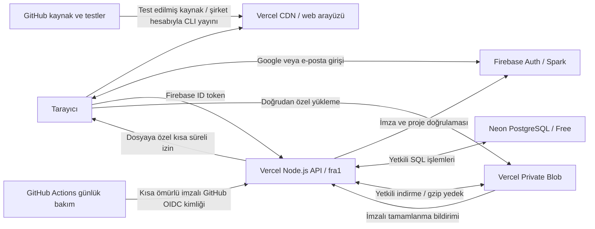

# Birlikte İyilik Ekip — mimari ve işletim rehberi

Son güncelleme: **10 Ekim 2026**. Projeyi devralan geliştirici için servis, veri ve işletim rehberi. Gerçek test/yayın durumu [DOĞRULAMA.md](DO%C4%9ERULAMA.md) içinde tutulur; bir servisin oluşturulması tüm canlı akışların doğrulandığı anlamına gelmez.

## Amaç, sahiplik ve karar

Birlikte İyilik ekibinin proje, organizasyon, görev, toplantı ve dosyalarını yönetmesi için bir **web sitesi**.

| Kaynak | Son yapılandırma |
| --- | --- |
| Adres | `https://ekip.birlikteiyilik.com` |
| Kaynak deposu | `birlikteiyilik/birlikte-iyilik-ekip` |
| Commit ve push hesabı | `augrclk` |
| Vercel takımı | `birlikteiyilikakademi-8992s-projects` — birlikteiyilik hesabı |
| Vercel projesi/dalı | `birlikte-iyilik-ekip` / `main` |
| Vercel proje kimliği | `prj_UYc23eeMDrVhlPLZ0gSAbKRB2Ywx` |
| Vercel takım kimliği | `team_0xhbl5nKwdqDc7EeaJBnQK8V` |
| Firebase | `birlikte-iyilik-ekip`, Spark |
| PostgreSQL | Neon Free: `birlikte-iyilik-ekip-db`, Frankfurt |
| Dosya alanı | Private Blob: `ekip-ozel-dosyalar`, Frankfurt `fra1` |

**Son karar: Firebase yalnız giriş için; ortak kayıtlar Vercel'e bağlı PostgreSQL'de.** Özel dosyalar ve sıkıştırılmış yedekler Blob'da. Bu dağılım ücretli Firebase Functions/Storage ve yönetici hizmet hesabı kurulumu gerektirmeden sunucu tarafında yetkilendirme sağlar.

Ana sitenin `birlikteiyilik/birlikteiyilik.com` deposuna ekip kodu veya verisi kopyalanmaz. Commit yazarı, repo sahibi, Vercel sahibi ve Firebase sahibi ayrı kavramlardır. Yanlış Vercel takımına bağlanmayın.



GitHub ekip verisinin yedeği değildir. Vercel'in geçici dosya sistemi kalıcı veritabanı değildir. Üretimde Firestore, Firebase Storage ve Firebase Cloud Functions kullanılmaz. Blaze, Google Cloud IAM/WIF veya hizmet hesabı özel anahtarı bu mimarinin parçası değildir.

## Kod haritası

| Yol | Sorumluluk |
| --- | --- |
| `web/` | Türkçe arayüz, organizasyon editörü, görev ekranları, marka varlıkları |
| `web/core.js`, `web/collab.js` | Belge doğrulama/hiyerarşi; alan değişiklikleri ve çakışmalar |
| `web/hub-model.js`, `web/coordination-model.js` | Tarih, görev, tekrar, bağımlılık, toplantı, rapor |
| `web/team.js`, `web/hub.js` | Ortak kayıt/dosya/geçmiş; panel ve ekip ekranları |
| `firebase/client.js`, `firebase/web-config.json` | Auth/API istemcisi; herkese açık Firebase web ayarları |
| `api/` | Vercel HTTP işlev girişleri |
| `server/admin.cjs`, `server/http.cjs` | ID token, ortam, boyut sınırı, hata ve yanıt başlıkları |
| `server/firebase-auth.cjs` | Üretimde Firebase ID token imza/claim doğrulaması; Google public JWKS + JOSE |
| `server/workspace.cjs` | Ekip üyeliği, roller ve ortak iş kuralları |
| `server/database.cjs` | SQL belge adaptörü, sorgu ve transaction |
| `server/storage.cjs` | Dosya rezervasyonu, doğrulama ve temizlik |
| `server/snapshots.cjs`, `server/backup.cjs` | Sürüm sıkıştırma; yedek, ZIP ve günlük bakım |
| `scripts/build.mjs`, `scripts/sync-shared.mjs` | Web build'i; üretimde doğrudan ortak kaynak kullanımı ve eski emülatöre kopyalama |
| `tests/` | Model, HTTP/PostgreSQL ve eski emülatör testleri |
| `.github/workflows/tests.yml` | Test/build; yayın tokenı kullanmaz |
| `.github/workflows/maintenance.yml`, `scripts/run-maintenance.mjs` | Günlük bakım çağrısı; kalıcı anahtar kullanmaz |
| `server/maintenance-auth.cjs` | GitHub işinin imza, depo, dal ve iş dosyasını doğrular |
| `vercel.json`, `.vercelignore` | Build, API/SPA yönlendirmesi, bölge, başlık ve yükleme kapsamı |
| `functions/`, `firebase.json`, Firebase kuralları | Korunan eski yerel emülatör düzeni; üretime dağıtılmayacak |

`dist/`, `functions/shared/`, `functions/workspace.cjs`, `functions/snapshots.cjs` üretilir. Kaynağı düzenleyip build/test çalıştırın; kopyaları elle düzenlemeyin. `node_modules`, `.vercel`, `.env*`, loglar ve emülatör verisi depoya girmez.

## Kimlik ve yetki

1. Firebase Auth Google veya e-posta/parola girişini yönetir; tarayıcı oturumu oturum kapsamında saklanır.
2. API'ye `Authorization: Bearer <Firebase ID token>` gönderilir. Parola API/SQL'e gönderilmez.
3. Sunucu JOSE ile yalnız RS256 imzasını, sabit Google JWKS adresindeki `kid` anahtarını, `exp`/`iat`/`auth_time`, tam issuer/audience ve geçerli `sub` bilgisini doğrular. Kullanıcı kimliği imzalı `sub` değerinden alınır; özel yönetici anahtarı kullanılmaz. Firebase Admin SDK yalnız izole emülatörde yüklenir; üretimdeki `jwks-rsa`/ESM çalışma hatası böyle giderilir.
4. Doğrulanmış e-posta ve PostgreSQL'de aktif ekip profili gerekir. İlk girişte kurucu dışındaki hesap için geçerli davet aranır.
5. Her işlem çalışma üyeliği ve gerekli rolü denetler. Üye erişebildiği çalışmanın bütününü görür; kart bazında gizlilik yoktur.

Kurucu, doğrulanmış `birlikteiyilikakademi@gmail.com` hesabıdır. Kurucu/kendi yönetici erişimini yanlışlıkla kaldırma engellenir. Davet 7 gün geçerli, seçilen çalışma/role bağlı ve ilk başarılı girişte tüketilir. Davet bağlantısını yönetici paylaşır; uygulama ekip davet e-postası göndermez.

| Rol | İzin |
| --- | --- |
| Kurum `admin` | Kullanıcı, davet ve tüm çalışmalar |
| Çalışma `manager` | İçerik, üyelik, arşiv, geri yükleme ve yedek |
| `editor` | İçerik, görev, yorum, toplantı ve dosya |
| `commenter` | Görüntüleme ve yorum |
| `viewer` | Görüntüleme ve çalışma dosyalarını indirme |

Ekip profilini `active=false` yapmak sonraki istekte erişimi keser. Token doğrulaması `checkRevoked` kullanmaz: Firebase hesabını kapatmak eldeki ID tokenı hemen iptal etmiş sayılmaz. Acil erişim kesme için ekip profilini de pasifleştirin.

API `private, no-store` ve `nosniff` döner; hassas bağlantı/hata metni tarayıcıya verilmez. Bellekte kullanıcı/dakika istek sınırı işlev örneği başınadır, kesin küresel kota değildir. Preview canlı verilere bağlanmaz. Üretimde emülatör ortam değişkenleri reddedilir.

## PostgreSQL modeli

Mevcut iş kuralları JSONB belge adaptörüyle korunmuştur. Kodda `collection/doc` adları bulunması üretimde Firestore kullanıldığı anlamına gelmez.

```sql
CREATE TABLE IF NOT EXISTS ekip_documents (
  path text PRIMARY KEY,
  parent_path text NOT NULL,
  document_id text NOT NULL,
  data jsonb NOT NULL
);
CREATE INDEX IF NOT EXISTS ekip_parent_idx ON ekip_documents(parent_path);
```

İlk istekte tablo/indeks oluşturulur. Sonraki şema değişiklikleri için açık migration gerekir; oluşturma metnini değiştirmek mevcut tabloyu dönüştürmez. Sorgu değerleri parametreli SQL'dir. İşlev örneği başına havuz en fazla 3 bağlantıdır.

| Belge yolu | İçerik |
| --- | --- |
| `users/{firebaseUid}` | Ekip adı/e-posta, kurum rolü ve aktiflik; parola/token yok |
| `invitations/{email}` | Hedef çalışma, rol, süre ve davet eden |
| `boards/{boardId}` | Ad, JSON içerik, revision, üyeler/roller, arşiv ve tarihler |
| `boards/{id}/meta/{nodeId}` | Bağımlılık, tekrar, ayar revision ve istek özeti |
| `boards/{id}/comments/{id}` | Kart yorumu, yazarı, tarih ve silinme işareti |
| `boards/{id}/events/{id}` | Toplantı, tutanak, kararlar ve revision |
| `boards/{id}/files/{id}` | Blob yolu, boyut/tür, rezervasyon ve yükleme durumu |
| `boards/{id}/audit/{id}` | Kim/ne/zaman hareketi |
| `boards/{id}/snapshots/{revision}` | Gzip/Base64 organizasyon belgesi |
| `boards/{id}/operations/{id}` | Kayıt isteği tekrarını tanıma |
| `boards/{id}/notifications/{id}` | Üyeye özel bildirim |
| `boards/{id}/completions/{id}` | Gerçek tamamlanma tarihi |
| `system/storage`, `system/backup`, `system/maintenance` | Bütçe, son yedek ve günlük iş durumu |
| `backups/{UTC-date}` | Blob yolu, SHA-256, boyut ve tarih |

Yazma `SERIALIZABLE` transaction içindedir; serialization/deadlock için sınırlı yeniden deneme vardır. Transaction okumaları yazmalardan önce tamamlanır. Tek çalışmanın yedeği `REPEATABLE READ READ ONLY` ile tutarlı okunur; bütün çalışmalar için tek küresel an garanti edilmez.

## Kayıt ve eşzamanlılık

İstemci son bilinen belgeye göre alan değişikliklerini çıkarır. Farklı alanlar birleştirilebilir; aynı alanda uyumsuzluk `409` ve güncel durumla döner. İşlem kimliği + istek özeti aynı kaydın tekrarını tekilleştirir; aynı kimlik farklı içerikte kullanılamaz.

Başarılı kayıtta revision, hareket, tamamlanma/atama bildirimi ve sıkıştırılmış sürüm birlikte yazılır. Ayar ve toplantı revision'ları eski formla kaydı engeller. Bağımlılık döngüsü, yanlış sorumlu ve tamamlanmamış bağlı görevler sunucuda doğrulanır.

Kaydetme 1,8 saniye sessizlikte toplanır; sürekli düzenlemede en fazla 5 saniyede gönderilir. Görünür çalışma yaklaşık 30 saniyede, yorumlar 45, panel 90 saniyede sorgulanır. Gizli/çevrimdışı sekmede sorgu yapılmaz. Bazı GET sonuçları istemcide 30, ortak panel ayrıntısı sunucuda 60 saniye tutulur; yetki güncel veriden denetlenir. Başka işlev örneğindeki panel değişikliği kısa gecikmeyle görülebilir.

Karakter karakter ortak metin yazımı ve canlı kişi mevcudiyeti yoktur. Çevrimdışı ortak kayıt tamamlanmış sayılmaz. Kaydedilmemiş taslak indirilebilir; limit aşımında veri kesilmez.

## HTTP API

| Uç | Yöntem / davranış |
| --- | --- |
| `/api/workspace` | POST `{path, method, body}` ile çalışma işlemleri |
| `/api/upload` | POST: yükleme izni ve imzalı Blob tamamlanma bildirimi |
| `/api/file?boardId=…&id=…` | GET: güncel üyelikten sonra özel dosya akışı |
| `/api/backup?boardId=…&mode=metadata` | GET: yöneticiye `.json.gz` |
| `/api/backup?boardId=…&mode=full` | GET: yöneticiye kayıt + mevcut dosyalar ZIP |
| `/api/maintenance` | GET: doğrulanmış GitHub Actions OIDC kimliği; POST: Firebase ile doğrulanmış kurum yöneticisi |

Workspace yolları `/me`, `/hub`, `/boards`, `/users`, `/directory`, `/invitations`, `/notifications`; çalışma altında `changes`, `restore`, `members`, `archive`, `history`, `snapshots`, `comments`, `meta`, `events`, `files`. Sözleşme ve izinler `server/workspace.cjs` içindedir. Tarayıcı PostgreSQL'e doğrudan bağlanmaz.

## Özel dosyalar

Sunucu aktif düzenleyici/geçerli kart için boyutu bütçeye atomik ayırır. Yol `boards/{boardId}/{nodeId}/{fileId}`, rezervasyon 1 saattir. `uploadPresigned/handleUploadPresigned` yalnız bu yol/tür/boyut için 10 dakikalık izin verir. Dosya doğrudan Blob'a gider; işlev gövdesinden geçirilmez.

Tamamlanma imzasını SDK denetler; sunucu gerçek boyut/türü, üyeliği ve kartı yeniden denetleyip `ready` yapar. İstemci tamamlamayı tekrar güvenle isteyebilir. İndirme her seferinde üyelik denetler; Blob herkese açık yapılmaz.

Sunucu Blob erişimi bağlı `BLOB_STORE_ID` ve Vercel OIDC ile sağlanır; uzun ömürlü `BLOB_READ_WRITE_TOKEN` gerekmez. PDF, belirtilen Office türleri, ZIP, TXT/CSV, PNG/JPEG/WebP kabul edilir. HTML/SVG kabul edilmez. MIME kontrolü antivirüs taraması değildir; dosya indirme eki ve `nosniff` ile sunulur.

Kaldırılan dosya önce işaretlenir. Günlük iş 7 günden eski kaldırılmış dosyaları ve süresi geçmiş yarım yüklemeleri fiziksel silip bütçeyi serbest bırakır; bir çalışmada en fazla 100 dosya temizlenir. Bu temizlikten sonra eski dosya bağlantısının çalışacağı garanti edilmez.

## Ücretsiz kapasite

Firebase Spark, Vercel Hobby ve Neon Free seçilir; ücretli plan/faturalandırma açılmaz. 10 Ekim 2026 kurulum ekranı Neon için proje başına 1 GB / 100 CU-saat, Blob Hobby için 1 GB alan / 10 GB aktarım gösteriyordu. Güncel Usage/Plan sayfası belirleyicidir; ücretsiz hizmet sınırsız değildir.

| Önlem/sınır | Amaç |
| --- | --- |
| Belge 750.000 UTF-8 bayt, 2.000 kart, 60 seviye | Kayıt ve sürüm büyümesini sınırlar |
| Kart 500 kontrol adımı, 100 bağlantı, 30 etiket | Kontrolsüz içerik büyümesini engeller |
| Dosya 10 MB; toplam rezervasyon 750 MiB | Blob'da yedek/temizlik payı bırakır |
| Yedek toplam 100 MiB, tek gzip 12 MiB | Ana dosya alanını korur |
| İlk sürüm + son 30 sıkıştırılmış sürüm | Her düzenlemede sınırsız tam kopya biriktirmez |
| Son 7 değişen günlük kayıt yedeği | Değişmeyen veriyi tekrar yazmaz |
| Tam ZIP dosyaları 100 MiB; günlük yedek 100 çalışma | İşlev/indirme hacmini sınırlar |
| Toplu kayıt, görünürlük ve kısa önbellek | API/SQL hesaplama yükünü azaltır |
| GitHub'da günde tek, en fazla 5 dakikalık bakım işi | Vercel'e sadece bakım isteği; özel deponun Actions dakika kotası ayrıca izlenir |

30 günden eski işlem kimlikleri ve okunmuş bildirimler bakımda sınırlı partilerle temizlenir. Hareketler, yorumlar, toplantılar ve tamamlanmalar topluca otomatik silinmez; büyümeleri izlenmelidir. PostgreSQL toplam boyutu için uygulamada kesin küresel alan kotası yoktur; sağlayıcı kotası ve kullanım takibi gerekir. Kota aşımı ücretli plana geçme talimatı değildir.

## Yedek ve geri yükleme

1. **Sürüm geçmişi:** organizasyon belgesi PostgreSQL'de gzip/Base64 tutulur. Yönetici gerekçeyle eski belgeyi yeni revision olarak geri yükler. Kullanıcı/yorum/toplantı/dosyaları geçmişe döndürmez; güncel bağımlılık/üyelik kontrolleri uygulanır.
2. **Kayıt yedeği:** `backups/{date}/{sha256}.json.gz` veya yönetici indirmesi. Güncel belge, meta, yorum, toplantı, dosya referansı, tamamlanmalar ve son 100 hareketi içerir. Otomatik toplu yedekte ekip profilleri de vardır. Parola/token, eski sürümler, davetler ve bütün eski hareketler kapsam dışıdır.
3. **Tam ZIP:** `workspace.json` + mevcut, kaldırılmamış dosyaların gerçek baytları. Günlük otomatik yedek dosyaları her gün çoğaltmaz.

Değişiklik özeti aynıysa yeni Blob yazılmaz. Yeni yedek ve metadata başarıyla kaydedilmeden eskiler budanmaz. Son 7 **farklı günlük kopya** tutulur; veri değişmiyorsa 7 takvim gününde son iyi kopya silinmez. Günlük anahtar UTC, görev/rapor tarihleri Türkiye saatidir.

Felaket kurtarma akışı:

1. Yazmayı durdurun, eldeki veriyi ayrıca kopyalayın; yeni izole PostgreSQL/özel Blob ortamında deneyin.
2. Gzip/ZIP açın; `format=birlikte-iyilik-backup`, `version=1`, proje ve SHA-256/JSON bütünlüğünü kontrol edin. ZIP'te dosya baytlarını da kontrol edin.
3. Organizasyon belgesi JSON aktarımıyla yeni çalışmaya alınabilir; bu diğer koleksiyonları ve üyelikleri kendiliğinden taşımaz.
4. Tam kayıt kurtarma için geliştirici yol modeline göre kontrollü import/migration hazırlamalıdır. Çalışma/alt kayıt/Blob yolları ve Firebase UID'leri birlikte eşlenir. Tam sistem yedeğini tek tuşla içeri alan ekran bu sürümde yoktur.
5. Dosyaları özel Blob'a koyup boyut/türü doğrulayın. Firebase kullanıcıları ayrıca yönetilir; Auth projesi değişirse UID eşleştirmesi gerekir.
6. İzole ortamda roller, kayıt, indirme ve yedekleri test edip canlı bağlantıyı değiştirin.

Yedekler özel ekip içeriği ve ad/e-posta içerebilir; GitHub/public Blob'a koymayın. Blob hesabının kaybında aynı hesap içindeki kopya yeterli değildir. Yönetici dönemsel tam ZIP'i kurumun başka, erişimi sınırlı konumunda saklamalıdır.

## Ortam değişkenleri

| Değişken | Kaynağı/kapsamı |
| --- | --- |
| `DATABASE_URL` | Neon bağlantısı ekler; yalnız Production, gizli |
| `BLOB_STORE_ID` | Özel Blob bağlantısı; yalnız Production |
| `BLOB_WEBHOOK_PUBLIC_KEY` | Blob imza doğrulama anahtarı; public key |
| `VERCEL_OIDC_TOKEN`, `VERCEL_ENV` | Vercel çalışma ortamı; elle kopyalanmaz |
| `DAL_LOCAL_API`, `FIREBASE_AUTH_EMULATOR_HOST` | Yalnız izole yerel API testleri |
| `DAL_EMULATORS` | Yalnız eski yerel Firebase arayüz build'i |

Neon başka `PG*/POSTGRES_*` değişkenleri ekleyebilir; kod yalnız `DATABASE_URL` kullanır. Firebase web API key'i public SDK ayarıdır, yönetici anahtarı değildir. Veritabanı parolası, Vercel tokenı, hizmet hesabı özel anahtarı ve gerçek ekip yedeğini kaynak/build/tarayıcı yapılandırmasına yazmayın.

## Yayın ve günlük bakım

Ekip deposu 12 Ekim 2026’da kullanıcının açık onayıyla **public** oldu; depo sahibi görünürlük değişikliğini yaptı ve GitHub API üzerinden doğrulandı. Commit/push hesabı **augrclk**, yayın hesabı **birlikteiyilikakademi-8992** olarak korunur. Yerleşik GitHub–Vercel bağlantısı `main` push’unu Production yayınına dönüştürür. Yayın tokenı isteyen ek Actions işi ve CLI scripti kaldırıldı; test ve günlük OIDC bakım işleri korunur. GitHub test işi yayın önünde bir kapı değildir; Vercel kendi build kontrolünü çalıştırır. Bu değişiklik yalnız kaynak görünürlüğüdür; Firebase Auth, üyelik/rol denetimi, Neon kayıtları ve özel Blob erişimi korunur. Akış [docs/OTOMATIK_YAYIN.md](docs/OTOMATIK_YAYIN.md), gerçek commit/yayın kanıtı **DOĞRULAMA.md** içindedir.

Framework `Other`, Node `22.x`, install `corepack pnpm install --frozen-lockfile`, build `pnpm test && pnpm build`, çıktı `dist`. `api/*.js` Node.js işlevi, bölge `fra1`, süre 60 saniye. SPA rewrite `/api` yollarını kapsamamalıdır. `.vercel/project.json` içindeki açık proje/takım kimliklerini yukarıdaki değerlerle karşılaştırın. CLI kaynağı gönderirken `.git`, `.env*`, yerel kimlik ve emülatör verileri dışarıda tutulur; GitHub commitleri `augrclk` olarak kalır.

GitHub test akışı model testleri, Auth/PGlite API testleri ve build çalıştırır; canlı anahtar kullanmaz. Native Vercel yayını GitHub testlerini kendiliğinden beklemez; bu yüzden build içinde model testleri vardır. Dal koruması/review ayrı yönetilir. Şirket CLI oturum bilgilerini CI'a kopyalamayın. Daha sonra özel CI yayını kurulursa yönetici sınırlı yayın anahtarını doğrudan CI secret alanında yapılandırır; anahtar kaynak koduna veya dokümana girmez.

Manuel yayın için test edilmiş, commit edilmiş kaynağı `.git` taşımadan ayrı geçici klasöre çıkarın. Bu bir kaynak dışa aktarımıdır; commit yazarı `augrclk` olarak kalır. Yayını şirket sahibi hesabı yapar; kaynak SHA'sı Vercel metadata'sında tutulur:

```sh
# Testleri geçen kaynak checkout'u içinde; GitHub işlemleri augrclk hesabıyla:
gh api user --jq .login
git push origin main

# Vercel oturumu şirket hesabı olmalı. IDs'yi yukarıdaki değerlerle karşılaştırın.
vercel whoami
releaseDir="$(mktemp -d)"
releaseSha="$(git rev-parse HEAD)"
git archive HEAD | tar -x -C "$releaseDir"
vercel --cwd "$releaseDir" link --yes --project birlikte-iyilik-ekip --scope birlikteiyilikakademi-8992s-projects
vercel --cwd "$releaseDir" deploy --prod --yes --meta "sourceCommit=$releaseSha" --scope birlikteiyilikakademi-8992s-projects
```

Kurulumda CLI `63.1.2` kullanıldı. Birden fazla hesap varsa CLI'ın `--global-config <yalnız-şirket-oturum-klasörü>` seçeneğini komutlara ekleyin; kimlik dosyalarını okumayın/kopyalamayın. `.env*` hiçbir kaynak dışa aktarımına veya GitHub'a girmemeli. Yeni yayında doğru şirket, `sourceCommit`, Ready ve `ekip.birlikteiyilik.com` eşlemesini doğrulayın. GitHub günlük bakım işi kaynak yayını yapmaz.

Alan adı şirket Vercel projesinde ve Firebase authorized domains listesinde olmalıdır. Sahiplik TXT, mevcut yönlendirme ve ana sitenin DNS kayıtlarını birlikte koruyun. Sahip/proje değişirse doğrulama değeri değişebilir; eski değeri ezbere kopyalamayın.

`.github/workflows/maintenance.yml` günlük `/api/maintenance` çağrısını `17 5 * * *` UTC tanımlar: Türkiye saatiyle yaklaşık 08.17. GitHub zamanlayıcısı gecikebilir; kesin dakika garantisi yoktur. Actions işi `id-token: write` ile sadece o çalıştırma için GitHub'ın imzaladığı kısa ömürlü OIDC kimliği alır. Elle `CRON_SECRET` eklenmez; `vercel.json` içinde ayrı bir cron yoktur.

API, RS256 imzasını GitHub'ın sabit JWKS adresiyle doğrular. Issuer `https://token.actions.githubusercontent.com`, audience `https://ekip.birlikteiyilik.com/api/maintenance`, en fazla 5 dakikalık kimlik yaşı gerekir. Depo adı yanında değişmez depo kimliği `1413149491`, sahibi `276585485`, `refs/heads/main`, tam `maintenance.yml@refs/heads/main` iş dosyası ve yalnız `schedule`/`workflow_dispatch` olayları denetlenir. Fork, PR ve başka iş dosyaları bakım yapamaz. Yeni kimlik formatındaki değişmez ID'li subject ve önceki subject biçimi desteklenir; ID kontrolleri ikisinde de zorunludur.

Kimlik doğrulaması olmayan GET `401`, yanlış depo/dal/iş `403` döner. Tekrar/son tarih bildirimleri, yedek, geçmiş budama ve dosya temizliği günlük işte yapılır. Tamamlanan günlük iş tekrar çalışmaz; başarısız iş yeniden denenebilir. Firebase ile doğrulanmış kurum yöneticisi POST ile bakımı ayrıca çalıştırabilir. Vercel Logs, GitHub bakım işinin sonucu, `system/maintenance` ve `system/backup` üzerinden izleyin. `failed` eski iyi yedeğin silindiği anlamına gelmez. Süre/kota sorununda hacmi azaltıp yeniden test edin; ücretli plana sessiz geçmeyin.

## Yerel geliştirme ve test

```sh
corepack enable
pnpm install --frozen-lockfile
pnpm test
pnpm test:api
pnpm build
pnpm preview
```

API testleri gerçek Auth emülatörü ve PGlite PostgreSQL sorgu motoruyla çalışır. Blob adaptörü bellektedir. Bakım kimliği testleri çalışma sırasında üretilmiş gerçek RS256 anahtarıyla imzalı kimliklerin depo/dal/süre/imza kontrollerini sınar. Gerçek GitHub iş kimliği, Vercel OIDC, Blob callback'i, Neon ağ bağlantısı ve DNS canlı uçtan uca test ister. PGlite test havuzu bağlantıları sıraya koyar; canlı Neon transaction yarışlarının tam yük testi değildir.

`preview` statik ekranlar içindir. Eski tam tarayıcı emülatörü Node 22 + Java 21 ile:

```sh
pnpm --dir functions install --frozen-lockfile
pnpm emulators
# Başka terminalde, sadece yerel demo ortamında:
FIREBASE_AUTH_EMULATOR_HOST=127.0.0.1:9099 FIRESTORE_EMULATOR_HOST=127.0.0.1:8080 node scripts/seed-emulator.cjs
```

Site `http://localhost:5500`; örnek hesap `admin@example.test`, parola `Test-only-website-2026`; sadece emülatör hesabıdır. `pnpm test:legacy-firebase` eski Auth/Functions/Firestore/Storage testidir; son mimarinin üretim kanıtı değildir. Testten önce aynı porttaki emülatörleri durdurun. Eski Functions/Storage'ı `firebase deploy` ile canlıya yayınlamayın.

## Devralma ve bilinen sınırlar

- Değişiklikten önce doğrulama belgesini okuyun; kurulu kaynak ile test edilmiş akışı ayırın.
- Test/build sonrası `augrclk` ile doğru depoya gönderin; şirket Vercel dağıtımının SHA/Ready durumunu kontrol edin.
- İki kullanıcıyla alan birleştirme/çakışma ve yenileme sonrası kaydı deneyin.
- Görüntüleyicinin yazamadığını, çıkarılan/pasif hesabın dosya indiremediğini kontrol edin.
- Günlük iş, son iyi yedek ve Blob/Neon/Functions kotalarını izleyin; izole geri yükleme provası yapın.
- API/şema değişince bu belge, README ve doğrulama kaydını birlikte güncelleyin.

E-posta/push bildirim, çift yönlü takvim, çevrimdışı ortak kayıt, karakter seviyesinde ortak metin, canlı kişi mevcudiyeti, antivirüs ve tek tuş tam sistem import yoktur. Ücretsiz kapasitenin yetmesi kullanım ve dosya hacmine bağlıdır.

## Resmî servis belgeleri

- [Firebase ID token doğrulama](https://firebase.google.com/docs/auth/admin/verify-id-tokens)
- [Vercel Blob SDK/presigned yükleme](https://vercel.com/docs/vercel-blob/using-blob-sdk)
- [Blob kullanım ve kota](https://vercel.com/docs/vercel-blob/usage-and-pricing)
- [GitHub Actions OIDC](https://docs.github.com/en/actions/reference/security/oidc)
- [Vercel özel depo/ekip yayın kuralları](https://vercel.com/docs/deployments/troubleshoot-project-collaboration)
- [Neon serverless driver](https://neon.com/docs/serverless/serverless-driver)

## Görsel dil ve düzenlenebilir örnek seti

`web/brand.css` temel marka katmanıdır; `web/usability.css` son arayüz katmanıdır: petrol menü, taş grisi arka plan, yeşil ana işlem. Yapılacak gri, devam eden mavi, bekleyen amber, tamamlanan yeşil, geciken/hata kırmızı görünür; durum metni de her zaman vardır. Proje/dal renkleri alanları ayırır. Orijinal logo dosyaları değiştirilmez. Mobilde ana menü açılır, pano yatay kayar; azaltılmış hareket tercihi korunur.

`web/examples.js` yalnız kurmaca örnek belge, yorum, toplantı ve bağımlılık planı üretir. `hub.js` içindeki kullanım rehberinden **kurum yöneticisi** mevcut `/boards`, `/comments`, `/events` ve `/meta` API'leriyle bu seti kaydeder. Bir organizasyon, üç proje, sekiz kişi kartı, 19 görev ve üç toplantı vardır. Kurulum tekrarında adları eşleşen çalışmalar tekrar oluşturulmaz; mevcut kayıtlar güncellenmez. Eksik yorum/toplantı/ayar adımları tamamlanabilir. Arşivdeki örnekler otomatik yeniden açılmaz. Yeni kayıtların tarihleri kurulumun Türkiye gününe göredir.

Sekiz örnek kişi `Kişi` kartıdır: Firebase hesabı, `users` kaydı, UID, parola, e-posta, davet veya proje yetkisi oluşturulmaz. Ekibimiz ekranındaki temsili profiller örnek birim kartlarından türetilir ve **Örnek kişi** etiketi taşır. Proje kartlarındaki temsili görev sorumlusu avatarları gerçek üyelik listesi değildir; yetki/sorumlu seçimi gerçek üyelik kaydına dayanır. Altı görevin hesap sorumlusu örnekleri ekleyen gerçek yöneticidir; diğer temsili sorumlu adları metin olarak tutulur.

Örnek çalışma adları `Örnek · ` ile başlar, belgeler `sample=true` taşır; kök kart `ekip-örnek-set-v1` etiketiyle tanınır. Rehberde **Örnekleri arşivle**, yalnız bu seti salt okunur arşive taşır; kalıcı silme yapmaz. Standart API yetkileri, sürüm/yedek ve kota kuralları bu kayıtlar için de geçerlidir. Gerçek çalışmaların üzerine yazılmaz. `tests/examples.test.cjs` biçim/sınır, durum/tarih, gerçek UID ayrımı ve toplantı/bağımlılık uçlarını denetler.

## Sade kullanıcı akışı ve ikon hareketi — 12 Ekim 2026

Girişten sonra **Bugün → görevi aç → durum/sorumlu/tarih → Kaydet** akışı öndedir. Ana ekran tek yeni görev eylemi, üç durum özeti ve son tarihe göre sıralanan kişisel işleri gösterir. Projeler tarihli İş planına açılır; şema ayrı, isteğe bağlı bir görünüm kalır. Ana gezintide Bugün, Görevlerim, Projeler ve Takvim bulunur. Ekibimiz, Organizasyon ve Haftalık rapor **Ekip ve düzen** altında; bildirimler üst çubuktadır. Mobilde kapalı menü `inert` olur ve klavye odağına girmez. Menü açma/kapatma odağı yönetilir.

Görev görünümünde Açık/Tamamlanan/Tümü filtreleri öndedir. Sorumlu/proje/tarih/durum filtreleri **Filtreler** altında; açıklama, öncelik ve kontrol listesi görev penceresinde **Açıklama ve küçük adımlar** altında açılır. Dosya, bağımlılık ve tekrar özellikleri **Dosyalar ve ek seçenekler** altında korunur. Kapalı `<details>` alanlarının form değerleri yine gönderilir; açıklama veya öncelik yanlışlıkla sıfırlanmaz. Alan bazlı kayıt, belirsiz işlem tekrar kimliği ve taslak/çakışma koruması değiştirilmez.

Şema zemini `#f3f6f8`, kartlar ve ayrıntı paneli beyazdır; eski pembe şema katmanı açık seçicilerle geçersiz kılınır. İlk açılış ve **Okunabilir görünüm**, seçili karta %78–100 aralığında odaklanır. **Ekrana sığdır** ise özellikle bütün yapıyı görmek içindir; büyük yapılarda bu görünüm küçülebilir. Ayrıntı paneli/ekran boyutu değişince şema tekrar küçültülmez. Kartın temel alanları öndedir; renk, tür, manuel ilerleme, iletişim ve hiyerarşi ayarları açılır ayrıntılardadır. Görünüm değişiklikleri ortak içerik veya yetki değişikliği değildir.

`web/icons.js` aynı SVG ikon üreticisini hub ve şema editöründe kullanır. Her path/circle/rect/line geometrisi `pathLength="1"` ile normalleştirilir. `web/motion.js` hover, klavye odağı ve dokunmada `strokeDashoffset` değerini 1’den 0’a indirerek çizgileri sırayla yeniden çizer; şekiller yer değiştirmez veya sallanmaz. Süre 620 ms, parça gecikmesi en fazla 180 ms’dir. WAAPI efektleri kesilebilir, tamamlanınca statik SVG’ye döner. Sayfa girişleri 280 ms’dir. Azaltılmış hareket tercihinde animasyon başlatılmaz; tercih değişir veya sekme gizlenirse çalışanlar iptal edilir. Sürekli ikon döngüsü ve yeni bağımlılık yoktur. Minimap/kenar çizgileri ile animasyonlu yüzde metninin kare güncellemeleri motion taramasını tekrar tetiklemez.

Bu akış yeni servis veya Firebase yetkisi eklemez. Şablonlar mevcut çalışma oluşturma API’sini kullanır; doğrulanan yerleşim enum’u aşağıdaki altı değere genişletilmiştir. Görsel testin sahte API adaptörü yalnız `work/` altındadır; kaynak deposuna ve üretime dahil edilmez.


## Hazır yapılar ve proje ilerlemesi — 12 Ekim 2026

`web/templates.js` DOM veya ağ gerektirmeyen bir şablon fabrikasıdır. Yönetici **Projeler → Hazır şemalar → Yapı seç → Proje adı** akışıyla yeni çalışma açar. Mevcut projeyi değiştirmez. Sekiz yönetim yapısı ve üç iş planı bulunur; yeni her örnek taze kart/ilişki kimlikleri alır. İçerik rol/birim/görev önerisidir; sorumlu UID, kişi iletişim bilgisi, tarih, dosya veya erişim izni üretmez. Makro birimler ve ekipler, mikro ise roller ve görevler üzerinde durur.

`core.js` içindeki `LAYOUTS`: `org`, `tree`, `mind`, `radial`, `pyramid`, `matrix`. Eski JSON belgeleri aynı biçim/sürümle açılır; bilinmeyen mod eski davranışla `org` olarak normalleşir. Radial algoritma yaprak sayısına göre açısal sektörleri paylaşır; halka yarıçapını aynı seviyenin en yakın iki kartı ile önceki halkaya göre hesaplar. Otomatik yerleşimde kart çakışması önlenir. Piramit her derinliği ortalanmış ayrı sıraya, matris kökün doğrudan birimlerini sütunlara yerleştirir. Matris şablonundaki proje rolleri satırlara hizalıdır ve dört gerçek çapraz ilişki içerir. Sonradan alt kart eklenebilir; manuel taşıma alt dala miras kalır ve bilinçli manuel çakışma mümkün olabilir. Kapalı dallar, tam dışa aktarım ve çizgi/halka geometrisi bütün modlarda çalışır.

Matris ilişki çizgisi ikinci bir yetki veya gerçek hesap raporlama hiyerarşisi oluşturmaz: tek `parentId` + etiketli `relations` modelidir. Dairesel halka çizgileri görsel kılavuzdur. Galeri SVG’si editörün aynı model hesabından çıkar; dış görsel veya üçüncü taraf şablon servisi yüklenmez. Şablondan oluşturulan yapı önce bütünüyle açılır; genel görünümde küçük bir karta tıklamak %78–100 okunabilir ayrıntı görünümüne geçer. Normal şema girişinde okunabilir görünüm korunur. **Görünüm → Yerleşim** mevcut belgede altı biçime geçmeyi sağlar; kişisel biçim seçimi ortak kaydı ve diğer ekranları değiştirmez. Yeni belgenin şablon yerleşimi başlangıç ayarı olarak sunucuda kalır.

Kart işlemleri artık çalışma araç çubuğundadır; tuvalde kök kartın üzerini kapatmaz. Temel kart alanları ve başlıklı Ayrıntılar düğmesi görünürdür. Hub gezinmesi `pushState`/`popstate` ile ilerler; Geri önce açık hub penceresini kapatır, sonraki gezinmede önceki ekrana döner. Belirsiz işlem veya kaydedilmemiş form koruması kalır. Editör geçişleri tam sayfa gezinmesidir ve mevcut bekleyen kayıt kontrolünü kullanır.

`hub-model.js/projectSummary` proje işlerini ve sorumlularını aynı hub kayıtlarından toplar; yeni API/poll eklenmez. Yüzde `tamamlanan / toplam iş` oranının yuvarlanmış değeridir. Hub’ın iş sayımında görev kartları ve bağımsız sorumlu/tarih taşıyan kontrol listesi adımları vardır; kartın elle girilen `progress` alanı projeye karıştırılmaz. Boş projede tamamlanma uydurulmaz. Gerçek UID’ler aynı adlı kullanıcıları ayrı tutar; örnek veya manuel isimli sorumlular rolü/UID’yi değiştirmez. Proje kartı yüzde, oran, açık/devam eden işleri ve sorumlu isimlerini; proje içindeki İş paylaşımı kişi bazında yapılan/açık işleri gösterir.

İlerleme hareketi `motion.js` içinde tam genişlikli çubuğa `scaleX` ile uygulanır. Yeni sayfa görünümünde görünür olan çubuk ve yüzde 0’dan gerçek değere 1000 ms’de birlikte ilerler; sonraki kayıt değişiminde eski değerden yenisine 650 ms’de geçer. Eğri `1-(1-t)^3` ve eşdeğer WAAPI cubic-bezier eğrisidir. IntersectionObserver yalnız görünür çizelgeleri başlatır. Aynı sayfada aynı değer poll/render ile tekrar animasyon almaz; yeni sayfaya geçişte görsel giriş yeniden oynar. Ekran okuyucunun `aria-valuenow` değeri her zaman gerçek orandır; animasyonlu sayı görsel bir kopyadır. Azaltılmış hareket veya gizli sekmede sayı doğrudan son değerine döner; sürekli sayaç döngüsü yoktur. Hover/focus ikonları, giriş ve ilerleme hareketleri azaltılmış hareket veya gizli sekme durumunda durur. Yerel `web/assets/fonts/Manrope-Variable.ttf` (SIL OFL 1.1) tek değişken fonttur; font kaynağı/lisansı aynı klasördedir. `font-display: swap` ve sistem fontu yedeği vardır; istemci dış font servisine bağlanmaz. Önizlemedeki sahte transport ve kurmaca QA kayıtları `work/` dışında dağıtılmaz.

Ürün referansları ve sonraki eksikler: [docs/URUN_KARSILASTIRMA.md](docs/URUN_KARSILASTIRMA.md).


## Otomatik web sunumu — 12 Ekim 2026

**Proje → Sunumu hazırla** ve **Şema → Görünüm → Sunumu hazırla** aynı akışı açar. Sunum hazırlama yeni endpoint kullanmaz: mevcut yetkili `/boards/:id` GET kaydını alır. Bekleyen şema kaydı varsa kullanıcıya kaydın bitmesini beklemesini söyler. Kaynak proje, üyelikler ve çalışma içeriği değişmez.

`presentation-model.js` DOM/ağ bağımsız deterministik üreticidir. Görev kartlarını ve hub ile aynı bağımsız kontrol listesi işlerini sayar. Kapak, amaç/yapı, gerçek tamamlanma oranı, en fazla beş sorumlu, son tarih önceliğiyle üç açık iş ve gerekirse dikkat gerektiren sayılardan **3–6 slayt** seçer. Yapı en fazla dört alan gösterir. Uzun metin kelime sınırından kısalır; gösterilmeyen alan/sorumlu/işlerin sayısı belirtilir. Boş projede ilerleme uydurulmaz. Tamamlanan projede açık iş veya gereksiz dikkat slaytı üretilmez. Tarihi geçen/bekleyen/atanmamış açık işler örtüşebilir; sunumda açıklama vardır. Kaynak alanlar düz metindir; görüntüleyici HTML kaçışı uygular.

Yapı slaytı gerçek kök ve en fazla dört doğrudan alanı bağlı SVG kartlarıyla gösterir. Klasik/yatay/zihin/dairesel/piramit/matris yerleşimlerini kullanır; her kartın tamamlanan/toplam işi ve yüzde barı vardır. Haritadan hazırlanınca kullanıcının seçtiği kişisel yerleşim yetkili kayıt kopyasına uygulanır; ortak belgeye yazılmaz. Seçili kartlar arasındaki en fazla altı gerçek çapraz bağ kesikli çizgi olarak gösterilir; diğer alan/bağlar için özet sayısı belirtilir. Mobilde okunabilir dikey şema ve dolan barlar kullanılır. İlerleme slaytı tamamlanan/açık iş dairesi, yanında durum sayılarıdır; devam edenler açık işlerin alt kümesidir. Kişi tablosu gerçek tamamlanma barları, sıradaki işler en fazla üç kartla gösterilir. Çizgiler ve barlar görünüm girişinde çizilir/dolar; sürekli döngü yoktur.

`presentation.js` yerel fontlu `presentation.css` ile tek kompozisyonlu, büyük yazılı bir web görüntüleyicisidir. Sonraki/Önceki ve numaralı slayt seçimi; ok/Space/PageUp/PageDown/Home/End klavye kontrolü, Escape/Kapat ve yerel tarayıcı fullscreen isteği vardır. Tarayıcı fullscreen’i reddederse normal pencereyi kaplayan sunum çalışır ve geri bildirim gösterilir. Hub Geri, açık sunumu önce kapatır. Klavye olayları açık sunumda alttaki görev/şema kısayollarına aktarılmaz. Kapatınca odak açan düğmeye döner ve slayt metni bellek/DOM’dan bırakılır.

İş sahiplerini gizlemek kişi slaytını kaldırır ve sıradaki işler üzerindeki sorumlu alanlarını boşaltır. Bu seçenek genel metindeki bütün özel isimleri redakte eden bir sistem değildir; proje adı ve amaç metni korunur. E-posta, telefon, serbest notlar, yorumlar, dosyalar, hesap UID’si veya token üretilecek slaytlara taşınmaz. Gizleme yeniden hazırlama ile yapılır; kaynak kayıt değişmez.

Sunum bir **anlık kayıt özeti** olarak kalır; canlı düzenleme, PPTX/PDF dışa aktarımı veya linkle paylaşma bu sürümün parçası değildir. Yeniden açmak güncel kayıttan yeniden üretir. Sunum açıkken hub poll’u durur; ek arka plan okuması, sunum tablosu, Blob dosyası, AI API veya abonelik yoktur. Kısa slayt girişi ve grafik dolumu WAAPI kullanır; azaltılmış hareket ve gizli sekme durumları desteklenir. Model testleri sayım/sıralama, sınırlı içerik, kaynak değişmezliği, özel alan dışlama, isim gizleme, boş/tamamlanan proje ve bağımsız kontrol listesi sayımını kapsar.


## Şema kartlarının otomatik iş ilerlemesi — 12 Ekim 2026

`core.js / branchProgress(doc)` her kart için `done`, `total`, `open`, `percent` döndürür. Bir kartın kendisi ve tüm hiyerarşik alt kartları hesaba katılır; kapalı dallar kapsamdan çıkmaz. Çapraz ilişkiler iş çoğaltmaz. Alt birim yüzdelerinin ortalaması alınmaz: üst kartın tamamlanan iş sayısı toplam iş sayısına bölünür. Böylece bir ve dokuz işi bulunan iki birimin ağırlığı eşit sayılmaz. Hesap belgeyi değiştirmez ve tek ağaç geçişinde çalışır; ek sunucu sorgusu, depolama alanı veya ücretli servis gerekmez.

Sayım günlük görev listesi ve otomatik sunumla aynıdır: Görev kartı tek iştir, Tamamlandı durumunda tamamlanmış sayılır. Görev kartındaki kontrol listesi maddeleri ancak sorumlu hesap veya son tarih taşıyorsa bağımsız iş sayılır; diğer maddeler görevin adımlarıdır. Birim/Kişi/Proje/Başlık kartındaki iş listesi maddeleri bağımsız iştir. Manuel `progress` alanı bu hesaba karışmaz; eski JSON/CSV/Markdown alanı ve gelişmiş manuel kontrol korunur. İş eklenmemiş yapılar Henüz iş yok gösterir; %100 uydurulmaz.

Şema kartları 238×168 pikseldir. Bütün altı yerleşim ve hazır şema önizlemeleri aynı model ölçüsünü kullanır. Kartta yüzde, tamamlanan/toplam ve çubuk bulunur; tamamlanan çubuk yeşil, diğerleri mavidir. Ayrıntı paneli ve tablo aynı türetilmiş değeri gösterir. SVG, dolayısıyla PNG/yazdırma görseli de bu tamamlanma özetini taşır. Ekran okuyucu kart etiketi ve progressbar aynı oranı bildirir. Çubuk hareketi mevcut `motion.js` mekanizmasını kullanır; yeniden seçimde aynı değer tekrar animasyon almaz, azaltılmış hareket/gizli sekme tercihlerine uyar. Görüntüdeki değerleri ayrıca veritabanına yazmak gerekmez.


## Tarihli iş planı ve mobil kullanım — 12 Ekim 2026

Projeler ve favoriler mevcut belgeyi `?board=<id>&mode=plan` adresinde açar. **İş planı / Harita / Tablo** aynı kaydı gösterir; sekmeler korunur, ayrı bir proje veya kontrol listesi veritabanı oluşmaz. Hazır yapı şablonları ilk oluşturulduğunda şema görünümüne açılmaya devam eder. Genel başlıklar altında yeni bir gruplama uygulanmadı; kullanıcının tercih ettiği doğrudan iş listesi korunur.

`web/work-plan-model.js` DOM/ağ bağımsız modeldir. Görev kartlarını ve diğer ekranlarla aynı kurala göre bağımsız kontrol listesi işlerini son tarihe göre sıralar. Aynı tarihte kaynak sırası sabittir; tarihsiz işler sonda görünür. Görev kartının hesap/süre taşımayan küçük adımları kendi satırı altında açılır, yüzde hesabına ikinci iş olarak eklenmez. Geçen tarihler gerçek Türkiye günüyle karşılaştırılır; başlangıç tarihi veya süre uydurulmaz. İlk 100 iş gösterilir, devamı düğmeyle açılır; toplam oran bütün belge üzerinden hesaplanır.

`web/work-plan.js` metin kaçışlı görünümü üretir. Kutuyu işaretlemek veya tarihi değiştirmek `app.js → guarded C.Store.change → DalTeam.queue → /boards/:id/changes` kayıt yolundan geçer. Aynı sunucu üyelik, bağımlılık, sürüm, çakışma ve yeniden deneme kuralları uygulanır. Yeni iş formu başlık, gerçek üye seçimi ve son tarihle kökün altına mevcut `Görev` kartını ekler. Görüntüleyicilerin formu yoktur, kontrolleri kapalıdır; sunucu yetkisi ayrıca korunur. Başlığa tıklamak kart ayrıntılarını açar; şema isteğe bağlı Harita sekmesinde kalır.

Liste yeniden çizildiğinde kaydırma, aktif tarih/kutu alanı ve açılmış küçük adımlar korunur. Tamamlananları gizle yalnız kişisel görünümü süzer; toplam ve yüzde değişmez. Form taslağı kayıt/poll sırasında korunur, iptal veya başarıdan sonra boşalır; dolu taslakla sayfadan ayrılmada tarayıcı uyarısı vardır. Haritaya dönüş mevcut okunabilir yakınlaştırmayı kullanır. Otomatik kayıt tamamlandığında sade durum metni gösterilir; hata ve bekleyen kayıt durumları gizlenmez.

`web/work-plan.css` sakin tarih çizgisi ve yatay satırları; `web/mobile.css` küçük ekran düzenini tanımlar. İş planı içerik genişliği 720 pikselin altına indiğinde sorumlu/tarih başlığın altına geçer; bu hem telefon hem menünün daralttığı tablet/panel durumlarını kapsar. 760 piksel altındaki şema araçları iki sıradır, sekmeler ikonlu ve en az 44 piksel yüksektir. Mobil ayrıntı paneli üst gezinmenin altında tam genişlikte açılır. Form alanları 16 piksel font, yerel tarih/seçim kontrolleri ve güvenli alan boşluğu kullanır.

Mobil tablo okunabilir fontuyla kendi içinde yatay kayar; ilk başlık sütunu ve tablo başlığı sabittir, kaydırma ipucu vardır. Yan menünün kapatma düğmesi bulunur; açıkken arka çalışma alanı `inert`, Tab odağı menü içinde, Escape odağı açan düğmeye geri götürür. Kapatılınca arka alan kullanılabilir olur. Bu kişisel görünüm davranışları ortak kayda veya erişim yetkisine yazılmaz.

Yazdır düğmesi bekleyen kayıt varsa bekletir; aksi halde tüm işleri içeren anlık bir HTML kağıt görünümü hazırlar ve tarayıcının yazdırma penceresini açar. Gizle/100 satır sınırı yazdırmada uygulanmaz. Özel notlar, iletişim ve link alanları bu çıktıya taşınmaz. Fiziksel baskı/PDF çıktısı bu turda doğrulanmadı.

Modelin altı testi sayım eşitliği, değişmezlik, doğru hedefe kayıt, hatalı tarihin atomik reddi, tamamlama filtresi/sınır, kimlik çakışması ve güvenli salt okunur/yazdırma HTML'ini denetler. Yeni API, poll, servis, Firebase yetkisi veya ücretli plan eklenmez.


## Profil ve özel fotoğraflar — 12 Ekim 2026

Profil sağ üstteki ad/fotoğraf düğmesinden; telefonda ana menünün altındaki hesabımdan açılır. Ad ve soyad ayrı alanlardır. `PATCH /me` yalnız kendi `firstName`, `lastName`, `avatar` alanlarını kabul eder; e-posta, rol, erişim durumu veya başka kullanıcı kimliği gönderilirse reddeder. Alanlar temizlenip doğrulanır ve PostgreSQL işleminde birleştirilir. Firebase Auth yalnız kimlik olarak kalır; isim ve fotoğraf için ikinci Firebase kaydı/yetkisi eklenmez. Davet formunun mevcut çalışma yetkisi seçimi korunur. Yeni bir pozisyon alanı eklenmedi.

`web/profile.js` JPEG/PNG/WebP kaynağını tarayıcı içinde ortadan kare kırpar ve 512×512 JPEG'e çevirir. Seçim sınırı 10 MB, kaydedilecek avatar sınırı 512 KB'dır. Kalite önce .92, gerekirse .84/.75/.65 kullanılır. Kullanıcı kaydetmeden önce önizlemeyi görür; özgün büyük dosya, dosya adı ve fotoğraf metadatası sunucuya taşınmaz. İlk 32 KB önerisi kullanıcı isteğiyle yükseltildi. Ad-soyad otomatik doldurma ve 16 px mobil form alanları vardır. Parola yenileme ayrı açılır alanda kalır.

`server/profile.cjs` isim, boyut, kanonik base64, MIME/imza ve en fazla 768×768 boyutunu denetler; SVG/uzak URL kabul etmez. Bu kontrol tam bir raster çözümleyici değildir; tarayıcı seçilen resmi çözümleyip yeniden kodlar. `server/storage.cjs/saveAvatar` mevcut **Private Blob** alanına `avatars/<uid>/<içerik sürümü>` yazar. Neon'da yalnız isim ve fotoğraf metadata/referansı tutulur, base64 fotoğraf saklanmaz. Fotoğraf bytes'ı `GET /profile-photos/:uid` ile kimlik doğrulamasından sonra okunur; kullanıcı kendisini, kurum yöneticisi aktif üyeyi, diğer üyeler yalnız ortak çalışmadaki aktif kişinin fotoğrafını okuyabilir. Genel dizin/hub yanıtları yalnız fotoğraf sürümü taşır, byte veya Blob URL'si taşımaz.

Fotoğraf alanı 50 MB ayrı bütçeyle sınırlıdır; dosya 750 MB ve yedek 100 MB bütçelerine eklenir. Kişi başına günde en fazla sekiz farklı fotoğraf yüklenebilir; aynı içerik tekrarında yeni nesne/kota oluşturulmaz. Kayıt tamamlanmadan önce byte rezervasyonu yapılır. Kesilen yükleme bir saat sonrasında, değiştirilen/kaldırılan fotoğraf yedi günlük yedek saklama süresi sonrasında temizlenir. Günlük bakım geçerli fotoğrafı silmez, yeniden seçilen sürüm için kısa rezervasyon tutar; Blob silinmeden önce kota serbest bırakılmaz. Bakım hatasında kayıt/kota korunur. Yeni Cron, ücretli plan veya Blob anahtarı kurulmaz.

Günlük yedek kullanıcı ve geçerli `profilePhotos` metadata kayıtlarını içerir. Profil fotoğrafının fiziksel byte'ları özel Blob'da kalır; board'a ait Tam ZIP fotoğrafları içermez. Referans geri yüklerken aynı Blob nesnelerinin mevcut olması gerekir; bu turda bütün sistem/felaket kurtarma provası yapılmadı. Eski fotoğraf referanslarının yedi günlük saklama sınırı vardır.

Avatar istemcisi yalnız görünür fotoğrafları, en fazla üç eşzamanlı istekle yükler. Cache yalnız açık sekmenin belleğinde, en fazla 24 görüntü / 12 MB'dır; tarayıcı localStorage/sessionStorage'a gerçek profil fotoğrafı yazılmaz. Yetki/eksik fotoğraf hatası aynı sürümde tekrar döngüsü yaratmaz; harfli avatar yedeği korunur. Kaynak QA adaptörü yalnız `work/` altında kalır.

`web/workspace-header.css` şemanın üst alanını daraltır: masaüstü üst gezinti 64, belge çubuğu 60, çalışma sekmeleri 52 px; İş planında belge çubuğu 32 px. Mobil üst gezinti 60, şema belge başlığı 60 px'dır; iki sıra ve 44 px dokunma hedefleri korunur. İş planı / Harita / Tablo kaldırılmaz.

Saatli ve bir iş tamamlanınca sonraki iş için iki saatlik süre başlatma fikri, yöneticinin sonuç kontrol listesi için bir sonraki ürün tasarımı olarak konuşuldu. Bu sürümde bağıl saat/süre geri sayımı uygulanmadı; mevcut tarih ve görev bağımlılığı kuralları korunur.


### Yönetici için sonuç kontrol listesi — tasarım yönü

Başkanın ilk bakışta işin sonucunu görmesi, yöneticinin de doğrudan basit bir sonuç listesi oluşturabilmesi hedeflenir. Ana satırda sonuç adı, tamamlanma kutusu, sorumlu ve son tarih yeterlidir; küçük adımlar ve şema ayrıntıları gerektiğinde açılır. Mevcut düz tarihli liste ve üç görünüm korunur.

Örnek gelecek bağlantı: “Program onaylandı” tamamlanınca “Duyuruyu paylaş” işi iki saat içinde tamamlanacak. İkinci iş öncesinde Bekliyor, tetiklenince kalan süre, süresi geçince Gecikti gösterilebilir. Bu henüz uygulanan bir özellik değildir. Tamamlama zamanı, bağımlılık döngüsü, ilk iş yeniden açıldığında davranış, saat dilimi ve yöneticinin süreyi elle değiştirmesi kararlaştırılmadan otomatik süre mekanizması eklenmez.

12 Ekim son sürümü şirket CLI ile canlıdadır. Yerleşik Git yayınının yeni `git_info_fail` hatası ve önceki başarı ayrımı docs/OTOMATIK_YAYIN.md ile DOĞRULAMA.md içinde tutulur; otomatik yayın yeniden düzelmiş kabul edilmez.
