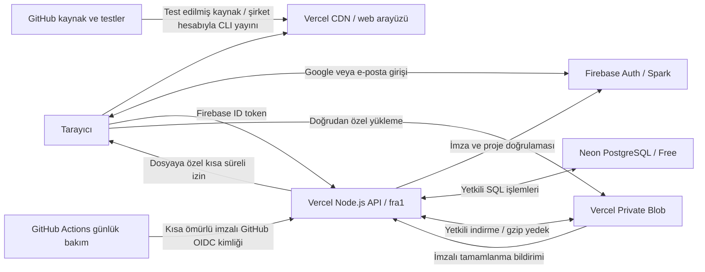

# Birlikte İyilik Ekip — mimari ve işletim rehberi

Son güncelleme: **10 Ekim 2026**. Projeyi devralan geliştirici için servis, veri ve işletim rehberi. Gerçek test/yayın durumu [DOĞRULAMA.md](DO%C4%9ERULAMA.md) içinde tutulur; bir servisin oluşturulması tüm canlı akışların doğrulandığı anlamına gelmez.

## Amaç, sahiplik ve karar

Birlikte İyilik ekibinin proje, organizasyon, görev, toplantı ve dosyalarını yönetmesi için bir **web sitesi**.

| Kaynak | Son yapılandırma |
| --- | --- |
| Adres | `https://ekip.birlikteiyilik.com` |
| Kaynak deposu | `birlikteiyilik/birlikte-iyilik-ekip` |
| Commit ve push hesabı | `augrclk` |
| Vercel takımı | `birlikteiyilikakademi-8992s-projects` — birlikteiyilik hesabı |
| Vercel projesi/dalı | `birlikte-iyilik-ekip` / `main` |
| Vercel proje kimliği | `prj_UYc23eeMDrVhlPLZ0gSAbKRB2Ywx` |
| Vercel takım kimliği | `team_0xhbl5nKwdqDc7EeaJBnQK8V` |
| Firebase | `birlikte-iyilik-ekip`, Spark |
| PostgreSQL | Neon Free: `birlikte-iyilik-ekip-db`, Frankfurt |
| Dosya alanı | Private Blob: `ekip-ozel-dosyalar`, Frankfurt `fra1` |

**Son karar: Firebase yalnız giriş için; ortak kayıtlar Vercel'e bağlı PostgreSQL'de.** Özel dosyalar ve sıkıştırılmış yedekler Blob'da. Bu dağılım ücretli Firebase Functions/Storage ve yönetici hizmet hesabı kurulumu gerektirmeden sunucu tarafında yetkilendirme sağlar.

Ana sitenin `birlikteiyilik/birlikteiyilik.com` deposuna ekip kodu veya verisi kopyalanmaz. Commit yazarı, repo sahibi, Vercel sahibi ve Firebase sahibi ayrı kavramlardır. Yanlış Vercel takımına bağlanmayın.



GitHub ekip verisinin yedeği değildir. Vercel'in geçici dosya sistemi kalıcı veritabanı değildir. Üretimde Firestore, Firebase Storage ve Firebase Cloud Functions kullanılmaz. Blaze, Google Cloud IAM/WIF veya hizmet hesabı özel anahtarı bu mimarinin parçası değildir.

## Kod haritası

| Yol | Sorumluluk |
| --- | --- |
| `web/` | Türkçe arayüz, organizasyon editörü, görev ekranları, marka varlıkları |
| `web/core.js`, `web/collab.js` | Belge doğrulama/hiyerarşi; alan değişiklikleri ve çakışmalar |
| `web/hub-model.js`, `web/coordination-model.js` | Tarih, görev, tekrar, bağımlılık, toplantı, rapor |
| `web/team.js`, `web/hub.js` | Ortak kayıt/dosya/geçmiş; panel ve ekip ekranları |
| `firebase/client.js`, `firebase/web-config.json` | Auth/API istemcisi; herkese açık Firebase web ayarları |
| `api/` | Vercel HTTP işlev girişleri |
| `server/admin.cjs`, `server/http.cjs` | ID token, ortam, boyut sınırı, hata ve yanıt başlıkları |
| `server/firebase-auth.cjs` | Üretimde Firebase ID token imza/claim doğrulaması; Google public JWKS + JOSE |
| `server/workspace.cjs` | Ekip üyeliği, roller ve ortak iş kuralları |
| `server/database.cjs` | SQL belge adaptörü, sorgu ve transaction |
| `server/storage.cjs` | Dosya rezervasyonu, doğrulama ve temizlik |
| `server/snapshots.cjs`, `server/backup.cjs` | Sürüm sıkıştırma; yedek, ZIP ve günlük bakım |
| `scripts/build.mjs`, `scripts/sync-shared.mjs` | Web build'i; üretimde doğrudan ortak kaynak kullanımı ve eski emülatöre kopyalama |
| `tests/` | Model, HTTP/PostgreSQL ve eski emülatör testleri |
| `.github/workflows/tests.yml` | Test/build; yayın tokenı kullanmaz |
| `.github/workflows/maintenance.yml`, `scripts/run-maintenance.mjs` | Günlük bakım çağrısı; kalıcı anahtar kullanmaz |
| `server/maintenance-auth.cjs` | GitHub işinin imza, depo, dal ve iş dosyasını doğrular |
| `vercel.json`, `.vercelignore` | Build, API/SPA yönlendirmesi, bölge, başlık ve yükleme kapsamı |
| `functions/`, `firebase.json`, Firebase kuralları | Korunan eski yerel emülatör düzeni; üretime dağıtılmayacak |

`dist/`, `functions/shared/`, `functions/workspace.cjs`, `functions/snapshots.cjs` üretilir. Kaynağı düzenleyip build/test çalıştırın; kopyaları elle düzenlemeyin. `node_modules`, `.vercel`, `.env*`, loglar ve emülatör verisi depoya girmez.

## Kimlik ve yetki

1. Firebase Auth Google veya e-posta/parola girişini yönetir; tarayıcı oturumu oturum kapsamında saklanır.
2. API'ye `Authorization: Bearer <Firebase ID token>` gönderilir. Parola API/SQL'e gönderilmez.
3. Sunucu JOSE ile yalnız RS256 imzasını, sabit Google JWKS adresindeki `kid` anahtarını, `exp`/`iat`/`auth_time`, tam issuer/audience ve geçerli `sub` bilgisini doğrular. Kullanıcı kimliği imzalı `sub` değerinden alınır; özel yönetici anahtarı kullanılmaz. Firebase Admin SDK yalnız izole emülatörde yüklenir; üretimdeki `jwks-rsa`/ESM çalışma hatası böyle giderilir.
4. Doğrulanmış e-posta ve PostgreSQL'de aktif ekip profili gerekir. İlk girişte kurucu dışındaki hesap için geçerli davet aranır.
5. Her işlem çalışma üyeliği ve gerekli rolü denetler. Üye erişebildiği çalışmanın bütününü görür; kart bazında gizlilik yoktur.

Kurucu, doğrulanmış `birlikteiyilikakademi@gmail.com` hesabıdır. Kurucu/kendi yönetici erişimini yanlışlıkla kaldırma engellenir. Davet 7 gün geçerli, seçilen çalışma/role bağlı ve ilk başarılı girişte tüketilir. Davet bağlantısını yönetici paylaşır; uygulama ekip davet e-postası göndermez.

| Rol | İzin |
| --- | --- |
| Kurum `admin` | Kullanıcı, davet ve tüm çalışmalar |
| Çalışma `manager` | İçerik, üyelik, arşiv, geri yükleme ve yedek |
| `editor` | İçerik, görev, yorum, toplantı ve dosya |
| `commenter` | Görüntüleme ve yorum |
| `viewer` | Görüntüleme ve çalışma dosyalarını indirme |

Ekip profilini `active=false` yapmak sonraki istekte erişimi keser. Token doğrulaması `checkRevoked` kullanmaz: Firebase hesabını kapatmak eldeki ID tokenı hemen iptal etmiş sayılmaz. Acil erişim kesme için ekip profilini de pasifleştirin.

API `private, no-store` ve `nosniff` döner; hassas bağlantı/hata metni tarayıcıya verilmez. Bellekte kullanıcı/dakika istek sınırı işlev örneği başınadır, kesin küresel kota değildir. Preview canlı verilere bağlanmaz. Üretimde emülatör ortam değişkenleri reddedilir.

## PostgreSQL modeli

Mevcut iş kuralları JSONB belge adaptörüyle korunmuştur. Kodda `collection/doc` adları bulunması üretimde Firestore kullanıldığı anlamına gelmez.

```sql
CREATE TABLE IF NOT EXISTS ekip_documents (
  path text PRIMARY KEY,
  parent_path text NOT NULL,
  document_id text NOT NULL,
  data jsonb NOT NULL
);
CREATE INDEX IF NOT EXISTS ekip_parent_idx ON ekip_documents(parent_path);
```

İlk istekte tablo/indeks oluşturulur. Sonraki şema değişiklikleri için açık migration gerekir; oluşturma metnini değiştirmek mevcut tabloyu dönüştürmez. Sorgu değerleri parametreli SQL'dir. İşlev örneği başına havuz en fazla 3 bağlantıdır.

| Belge yolu | İçerik |
| --- | --- |
| `users/{firebaseUid}` | Ekip adı/e-posta, kurum rolü ve aktiflik; parola/token yok |
| `invitations/{email}` | Hedef çalışma, rol, süre ve davet eden |
| `boards/{boardId}` | Ad, JSON içerik, revision, üyeler/roller, arşiv ve tarihler |
| `boards/{id}/meta/{nodeId}` | Bağımlılık, tekrar, ayar revision ve istek özeti |
| `boards/{id}/comments/{id}` | Kart yorumu, yazarı, tarih ve silinme işareti |
| `boards/{id}/events/{id}` | Toplantı, tutanak, kararlar ve revision |
| `boards/{id}/files/{id}` | Blob yolu, boyut/tür, rezervasyon ve yükleme durumu |
| `boards/{id}/audit/{id}` | Kim/ne/zaman hareketi |
| `boards/{id}/snapshots/{revision}` | Gzip/Base64 organizasyon belgesi |
| `boards/{id}/operations/{id}` | Kayıt isteği tekrarını tanıma |
| `boards/{id}/notifications/{id}` | Üyeye özel bildirim |
| `boards/{id}/completions/{id}` | Gerçek tamamlanma tarihi |
| `system/storage`, `system/backup`, `system/maintenance` | Bütçe, son yedek ve günlük iş durumu |
| `backups/{UTC-date}` | Blob yolu, SHA-256, boyut ve tarih |

Yazma `SERIALIZABLE` transaction içindedir; serialization/deadlock için sınırlı yeniden deneme vardır. Transaction okumaları yazmalardan önce tamamlanır. Tek çalışmanın yedeği `REPEATABLE READ READ ONLY` ile tutarlı okunur; bütün çalışmalar için tek küresel an garanti edilmez.

## Kayıt ve eşzamanlılık

İstemci son bilinen belgeye göre alan değişikliklerini çıkarır. Farklı alanlar birleştirilebilir; aynı alanda uyumsuzluk `409` ve güncel durumla döner. İşlem kimliği + istek özeti aynı kaydın tekrarını tekilleştirir; aynı kimlik farklı içerikte kullanılamaz.

Başarılı kayıtta revision, hareket, tamamlanma/atama bildirimi ve sıkıştırılmış sürüm birlikte yazılır. Ayar ve toplantı revision'ları eski formla kaydı engeller. Bağımlılık döngüsü, yanlış sorumlu ve tamamlanmamış bağlı görevler sunucuda doğrulanır.

Kaydetme 1,8 saniye sessizlikte toplanır; sürekli düzenlemede en fazla 5 saniyede gönderilir. Görünür çalışma yaklaşık 30 saniyede, yorumlar 45, panel 90 saniyede sorgulanır. Gizli/çevrimdışı sekmede sorgu yapılmaz. Bazı GET sonuçları istemcide 30, ortak panel ayrıntısı sunucuda 60 saniye tutulur; yetki güncel veriden denetlenir. Başka işlev örneğindeki panel değişikliği kısa gecikmeyle görülebilir.

Karakter karakter ortak metin yazımı ve canlı kişi mevcudiyeti yoktur. Çevrimdışı ortak kayıt tamamlanmış sayılmaz. Kaydedilmemiş taslak indirilebilir; limit aşımında veri kesilmez.

## HTTP API

| Uç | Yöntem / davranış |
| --- | --- |
| `/api/workspace` | POST `{path, method, body}` ile çalışma işlemleri |
| `/api/upload` | POST: yükleme izni ve imzalı Blob tamamlanma bildirimi |
| `/api/file?boardId=…&id=…` | GET: güncel üyelikten sonra özel dosya akışı |
| `/api/backup?boardId=…&mode=metadata` | GET: yöneticiye `.json.gz` |
| `/api/backup?boardId=…&mode=full` | GET: yöneticiye kayıt + mevcut dosyalar ZIP |
| `/api/maintenance` | GET: doğrulanmış GitHub Actions OIDC kimliği; POST: Firebase ile doğrulanmış kurum yöneticisi |

Workspace yolları `/me`, `/hub`, `/boards`, `/users`, `/directory`, `/invitations`, `/notifications`; çalışma altında `changes`, `restore`, `members`, `archive`, `history`, `snapshots`, `comments`, `meta`, `events`, `files`. Sözleşme ve izinler `server/workspace.cjs` içindedir. Tarayıcı PostgreSQL'e doğrudan bağlanmaz.

## Özel dosyalar

Sunucu aktif düzenleyici/geçerli kart için boyutu bütçeye atomik ayırır. Yol `boards/{boardId}/{nodeId}/{fileId}`, rezervasyon 1 saattir. `uploadPresigned/handleUploadPresigned` yalnız bu yol/tür/boyut için 10 dakikalık izin verir. Dosya doğrudan Blob'a gider; işlev gövdesinden geçirilmez.

Tamamlanma imzasını SDK denetler; sunucu gerçek boyut/türü, üyeliği ve kartı yeniden denetleyip `ready` yapar. İstemci tamamlamayı tekrar güvenle isteyebilir. İndirme her seferinde üyelik denetler; Blob herkese açık yapılmaz.

Sunucu Blob erişimi bağlı `BLOB_STORE_ID` ve Vercel OIDC ile sağlanır; uzun ömürlü `BLOB_READ_WRITE_TOKEN` gerekmez. PDF, belirtilen Office türleri, ZIP, TXT/CSV, PNG/JPEG/WebP kabul edilir. HTML/SVG kabul edilmez. MIME kontrolü antivirüs taraması değildir; dosya indirme eki ve `nosniff` ile sunulur.

Kaldırılan dosya önce işaretlenir. Günlük iş 7 günden eski kaldırılmış dosyaları ve süresi geçmiş yarım yüklemeleri fiziksel silip bütçeyi serbest bırakır; bir çalışmada en fazla 100 dosya temizlenir. Bu temizlikten sonra eski dosya bağlantısının çalışacağı garanti edilmez.

## Ücretsiz kapasite

Firebase Spark, Vercel Hobby ve Neon Free seçilir; ücretli plan/faturalandırma açılmaz. 10 Ekim 2026 kurulum ekranı Neon için proje başına 1 GB / 100 CU-saat, Blob Hobby için 1 GB alan / 10 GB aktarım gösteriyordu. Güncel Usage/Plan sayfası belirleyicidir; ücretsiz hizmet sınırsız değildir.

| Önlem/sınır | Amaç |
| --- | --- |
| Belge 750.000 UTF-8 bayt, 2.000 kart, 60 seviye | Kayıt ve sürüm büyümesini sınırlar |
| Kart 500 kontrol adımı, 100 bağlantı, 30 etiket | Kontrolsüz içerik büyümesini engeller |
| Dosya 10 MB; toplam rezervasyon 750 MiB | Blob'da yedek/temizlik payı bırakır |
| Yedek toplam 100 MiB, tek gzip 12 MiB | Ana dosya alanını korur |
| İlk sürüm + son 30 sıkıştırılmış sürüm | Her düzenlemede sınırsız tam kopya biriktirmez |
| Son 7 değişen günlük kayıt yedeği | Değişmeyen veriyi tekrar yazmaz |
| Tam ZIP dosyaları 100 MiB; günlük yedek 100 çalışma | İşlev/indirme hacmini sınırlar |
| Toplu kayıt, görünürlük ve kısa önbellek | API/SQL hesaplama yükünü azaltır |
| GitHub'da günde tek, en fazla 5 dakikalık bakım işi | Vercel'e sadece bakım isteği; özel deponun Actions dakika kotası ayrıca izlenir |

30 günden eski işlem kimlikleri ve okunmuş bildirimler bakımda sınırlı partilerle temizlenir. Hareketler, yorumlar, toplantılar ve tamamlanmalar topluca otomatik silinmez; büyümeleri izlenmelidir. PostgreSQL toplam boyutu için uygulamada kesin küresel alan kotası yoktur; sağlayıcı kotası ve kullanım takibi gerekir. Kota aşımı ücretli plana geçme talimatı değildir.

## Yedek ve geri yükleme

1. **Sürüm geçmişi:** organizasyon belgesi PostgreSQL'de gzip/Base64 tutulur. Yönetici gerekçeyle eski belgeyi yeni revision olarak geri yükler. Kullanıcı/yorum/toplantı/dosyaları geçmişe döndürmez; güncel bağımlılık/üyelik kontrolleri uygulanır.
2. **Kayıt yedeği:** `backups/{date}/{sha256}.json.gz` veya yönetici indirmesi. Güncel belge, meta, yorum, toplantı, dosya referansı, tamamlanmalar ve son 100 hareketi içerir. Otomatik toplu yedekte ekip profilleri de vardır. Parola/token, eski sürümler, davetler ve bütün eski hareketler kapsam dışıdır.
3. **Tam ZIP:** `workspace.json` + mevcut, kaldırılmamış dosyaların gerçek baytları. Günlük otomatik yedek dosyaları her gün çoğaltmaz.

Değişiklik özeti aynıysa yeni Blob yazılmaz. Yeni yedek ve metadata başarıyla kaydedilmeden eskiler budanmaz. Son 7 **farklı günlük kopya** tutulur; veri değişmiyorsa 7 takvim gününde son iyi kopya silinmez. Günlük anahtar UTC, görev/rapor tarihleri Türkiye saatidir.

Felaket kurtarma akışı:

1. Yazmayı durdurun, eldeki veriyi ayrıca kopyalayın; yeni izole PostgreSQL/özel Blob ortamında deneyin.
2. Gzip/ZIP açın; `format=birlikte-iyilik-backup`, `version=1`, proje ve SHA-256/JSON bütünlüğünü kontrol edin. ZIP'te dosya baytlarını da kontrol edin.
3. Organizasyon belgesi JSON aktarımıyla yeni çalışmaya alınabilir; bu diğer koleksiyonları ve üyelikleri kendiliğinden taşımaz.
4. Tam kayıt kurtarma için geliştirici yol modeline göre kontrollü import/migration hazırlamalıdır. Çalışma/alt kayıt/Blob yolları ve Firebase UID'leri birlikte eşlenir. Tam sistem yedeğini tek tuşla içeri alan ekran bu sürümde yoktur.
5. Dosyaları özel Blob'a koyup boyut/türü doğrulayın. Firebase kullanıcıları ayrıca yönetilir; Auth projesi değişirse UID eşleştirmesi gerekir.
6. İzole ortamda roller, kayıt, indirme ve yedekleri test edip canlı bağlantıyı değiştirin.

Yedekler özel ekip içeriği ve ad/e-posta içerebilir; GitHub/public Blob'a koymayın. Blob hesabının kaybında aynı hesap içindeki kopya yeterli değildir. Yönetici dönemsel tam ZIP'i kurumun başka, erişimi sınırlı konumunda saklamalıdır.

## Ortam değişkenleri

| Değişken | Kaynağı/kapsamı |
| --- | --- |
| `DATABASE_URL` | Neon bağlantısı ekler; yalnız Production, gizli |
| `BLOB_STORE_ID` | Özel Blob bağlantısı; yalnız Production |
| `BLOB_WEBHOOK_PUBLIC_KEY` | Blob imza doğrulama anahtarı; public key |
| `VERCEL_OIDC_TOKEN`, `VERCEL_ENV` | Vercel çalışma ortamı; elle kopyalanmaz |
| `DAL_LOCAL_API`, `FIREBASE_AUTH_EMULATOR_HOST` | Yalnız izole yerel API testleri |
| `DAL_EMULATORS` | Yalnız eski yerel Firebase arayüz build'i |

Neon başka `PG*/POSTGRES_*` değişkenleri ekleyebilir; kod yalnız `DATABASE_URL` kullanır. Firebase web API key'i public SDK ayarıdır, yönetici anahtarı değildir. Veritabanı parolası, Vercel tokenı, hizmet hesabı özel anahtarı ve gerçek ekip yedeğini kaynak/build/tarayıcı yapılandırmasına yazmayın.

## Yayın ve günlük bakım

Vercel Git bağlantısı ekip deposuna bağlıdır. Ancak 10 Ekim 2026'da Hobby planı özel depodaki `augrclk` yazarlı `4cf53b0` yayınını, yazarı şirket Vercel takımına dahil olmadığı için engelledi; şirket panelindeki Redeploy da Pro yükseltmesini istedi. Commit yazarı değiştirilmez, depo herkese açılmaz ve ücretli plan seçilmez. Şirket sahibi hesabıyla standart CLI yayını hazırlanır. Otomatik kaynak yayını çalıştığı doğrulanmadan bu Git bağlantısının yeterli olduğu varsayılmamalıdır.

Framework `Other`, Node `22.x`, install `corepack pnpm install --frozen-lockfile`, build `pnpm test && pnpm build`, çıktı `dist`. `api/*.js` Node.js işlevi, bölge `fra1`, süre 60 saniye. SPA rewrite `/api` yollarını kapsamamalıdır. `.vercel/project.json` içindeki açık proje/takım kimliklerini yukarıdaki değerlerle karşılaştırın. CLI kaynağı gönderirken `.git`, `.env*`, yerel kimlik ve emülatör verileri dışarıda tutulur; GitHub commitleri `augrclk` olarak kalır.

GitHub test akışı model testleri, Auth/PGlite API testleri ve build çalıştırır; canlı anahtar kullanmaz. Native Vercel yayını GitHub testlerini kendiliğinden beklemez; bu yüzden build içinde model testleri vardır. Dal koruması/review ayrı yönetilir. Şirket CLI oturum bilgilerini CI'a kopyalamayın. Daha sonra özel CI yayını kurulursa yönetici sınırlı yayın anahtarını doğrudan CI secret alanında yapılandırır; anahtar kaynak koduna veya dokümana girmez.

Alan adı şirket Vercel projesinde ve Firebase authorized domains listesinde olmalıdır. Sahiplik TXT, mevcut yönlendirme ve ana sitenin DNS kayıtlarını birlikte koruyun. Sahip/proje değişirse doğrulama değeri değişebilir; eski değeri ezbere kopyalamayın.

`.github/workflows/maintenance.yml` günlük `/api/maintenance` çağrısını `17 5 * * *` UTC tanımlar: Türkiye saatiyle yaklaşık 08.17. GitHub zamanlayıcısı gecikebilir; kesin dakika garantisi yoktur. Actions işi `id-token: write` ile sadece o çalıştırma için GitHub'ın imzaladığı kısa ömürlü OIDC kimliği alır. Elle `CRON_SECRET` eklenmez; `vercel.json` içinde ayrı bir cron yoktur.

API, RS256 imzasını GitHub'ın sabit JWKS adresiyle doğrular. Issuer `https://token.actions.githubusercontent.com`, audience `https://ekip.birlikteiyilik.com/api/maintenance`, en fazla 5 dakikalık kimlik yaşı gerekir. Depo adı yanında değişmez depo kimliği `1413149491`, sahibi `276585485`, `refs/heads/main`, tam `maintenance.yml@refs/heads/main` iş dosyası ve yalnız `schedule`/`workflow_dispatch` olayları denetlenir. Fork, PR ve başka iş dosyaları bakım yapamaz. Yeni kimlik formatındaki değişmez ID'li subject ve önceki subject biçimi desteklenir; ID kontrolleri ikisinde de zorunludur.

Kimlik doğrulaması olmayan GET `401`, yanlış depo/dal/iş `403` döner. Tekrar/son tarih bildirimleri, yedek, geçmiş budama ve dosya temizliği günlük işte yapılır. Tamamlanan günlük iş tekrar çalışmaz; başarısız iş yeniden denenebilir. Firebase ile doğrulanmış kurum yöneticisi POST ile bakımı ayrıca çalıştırabilir. Vercel Logs, GitHub bakım işinin sonucu, `system/maintenance` ve `system/backup` üzerinden izleyin. `failed` eski iyi yedeğin silindiği anlamına gelmez. Süre/kota sorununda hacmi azaltıp yeniden test edin; ücretli plana sessiz geçmeyin.

## Yerel geliştirme ve test

```sh
corepack enable
pnpm install --frozen-lockfile
pnpm test
pnpm test:api
pnpm build
pnpm preview
```

API testleri gerçek Auth emülatörü ve PGlite PostgreSQL sorgu motoruyla çalışır. Blob adaptörü bellektedir. Bakım kimliği testleri çalışma sırasında üretilmiş gerçek RS256 anahtarıyla imzalı kimliklerin depo/dal/süre/imza kontrollerini sınar. Gerçek GitHub iş kimliği, Vercel OIDC, Blob callback'i, Neon ağ bağlantısı ve DNS canlı uçtan uca test ister. PGlite test havuzu bağlantıları sıraya koyar; canlı Neon transaction yarışlarının tam yük testi değildir.

`preview` statik ekranlar içindir. Eski tam tarayıcı emülatörü Node 22 + Java 21 ile:

```sh
pnpm --dir functions install --frozen-lockfile
pnpm emulators
# Başka terminalde, sadece yerel demo ortamında:
FIREBASE_AUTH_EMULATOR_HOST=127.0.0.1:9099 FIRESTORE_EMULATOR_HOST=127.0.0.1:8080 node scripts/seed-emulator.cjs
```

Site `http://localhost:5500`; örnek hesap `admin@example.test`, parola `Test-only-website-2026`; sadece emülatör hesabıdır. `pnpm test:legacy-firebase` eski Auth/Functions/Firestore/Storage testidir; son mimarinin üretim kanıtı değildir. Testten önce aynı porttaki emülatörleri durdurun. Eski Functions/Storage'ı `firebase deploy` ile canlıya yayınlamayın.

## Devralma ve bilinen sınırlar

- Değişiklikten önce doğrulama belgesini okuyun; kurulu kaynak ile test edilmiş akışı ayırın.
- Test/build sonrası `augrclk` ile doğru depoya gönderin; şirket Vercel dağıtımının SHA/Ready durumunu kontrol edin.
- İki kullanıcıyla alan birleştirme/çakışma ve yenileme sonrası kaydı deneyin.
- Görüntüleyicinin yazamadığını, çıkarılan/pasif hesabın dosya indiremediğini kontrol edin.
- Günlük iş, son iyi yedek ve Blob/Neon/Functions kotalarını izleyin; izole geri yükleme provası yapın.
- API/şema değişince bu belge, README ve doğrulama kaydını birlikte güncelleyin.

E-posta/push bildirim, çift yönlü takvim, çevrimdışı ortak kayıt, karakter seviyesinde ortak metin, canlı kişi mevcudiyeti, antivirüs ve tek tuş tam sistem import yoktur. Ücretsiz kapasitenin yetmesi kullanım ve dosya hacmine bağlıdır.

## Resmî servis belgeleri

- [Firebase ID token doğrulama](https://firebase.google.com/docs/auth/admin/verify-id-tokens)
- [Vercel Blob SDK/presigned yükleme](https://vercel.com/docs/vercel-blob/using-blob-sdk)
- [Blob kullanım ve kota](https://vercel.com/docs/vercel-blob/usage-and-pricing)
- [GitHub Actions OIDC](https://docs.github.com/en/actions/reference/security/oidc)
- [Vercel özel depo/ekip yayın kuralları](https://vercel.com/docs/deployments/troubleshoot-project-collaboration)
- [Neon serverless driver](https://neon.com/docs/serverless/serverless-driver)
