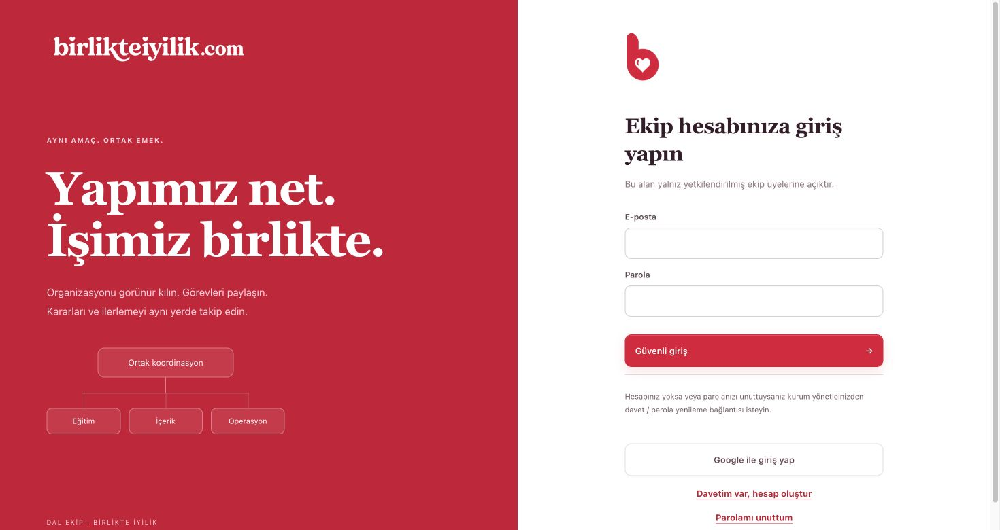
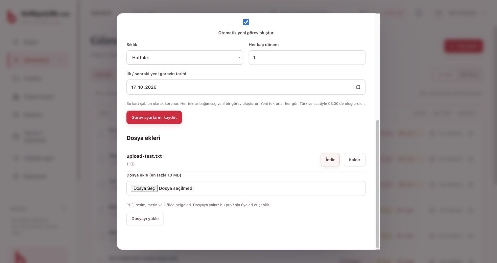

# Birlikte İyilik · Ekip çalışma alanı

Birlikte İyilik ekibinin projelerini, görevlerini, organizasyonunu ve toplantılarını ortak bir yerde takip ettiği Türkçe web sitesi. Mevcut Dal organizasyon editörü korunarak Firebase tabanlı giriş ve ortak kayıt altyapısına geçirildi. Marka rengi `#e20439`, beyaz yüzeyler ve kurumun sağladığı logo dosyaları kullanılır.

## Ekranlar

Yerel Firebase emülatöründeki örnek hesaplarla alınan görüntüler:





## Özellikler

- E-posta/parola veya Google ile giriş, e-posta doğrulama, davetle ekip erişimi ve parola yenileme.
- Proje bazında yönetici, düzenleyici, yorumcu ve görüntüleyici yetkileri; hesabı pasifleştirme.
- Bugün, Görevlerim, liste/pano, ekip ve organizasyon ekranları; sorumlu, tarih, öncelik, kontrol listesi ve yorumlar.
- Aynı alandaki eşzamanlı değişikliği fark eden kayıt sistemi, işlem kimliğiyle güvenli yeniden deneme, geçmiş sürümleri indirme ve yönetici geri yüklemesi.
- Görev bağımlılıkları ve döngü kontrolü; önceki işler bitmeden tamamlama engeli.
- Günlük/haftalık/aylık tekrar: şablonu koruyup bağımsız yeni görev oluşturma; ay sonu tarihini koruma.
- Projeye özel dosyalar: PDF, PNG/JPEG/WebP, TXT, DOCX/XLSX/PPTX; 10 MB sınırı ve üyelik kontrolü.
- Toplantı gündemi, katılımcılar, tutanak ve mevcut görevlere bağlı kararlar; `.ics` takvim aktarımı.
- Gerçek tamamlanma kayıtlarına dayalı haftalık rapor ve CSV indirme.
- Uygulama içi atama, bahsetme, toplantı ve son tarih bildirimleri.
- Mobil tarayıcıya uyumlu ekranlar; sayfa, kart, pencere ve buton hareketleri. Hareket azaltma tercihi desteklenir.

## Altyapı

Tarayıcıdaki JavaScript arayüzü Firebase Auth ile giriş yapar. Ortak kayıtlar `europe-west3` bölgesindeki `workspace` Cloud Function üzerinden Firestore'a yazılır. İşlev her istekte doğrulanmış e-posta, aktif hesap ve proje yetkisini denetler. Firestore kuralları tarayıcıdan doğrudan veriye erişimi kapatır. Storage kuralları dosyaları proje üyeliğine göre korur. Günlük `dailyCoordination` görevi Türkiye saatiyle 08.00'de tekrarları ve son tarih bildirimlerini oluşturur.

`firebase/web-config.json` herkese açık web uygulaması yapılandırmasıdır; yönetici anahtarı içermez. Hizmet hesabı veya özel anahtar depoya eklenmez. Kurucu yönetici, doğrulanmış `birlikteiyilikakademi@gmail.com` hesabıdır. Diğer hesapların önceden davet edilmesi gerekir.

## Kurulum ve yerel geliştirme

Node.js 22, pnpm ve emülatörler için Java 21 gerekir.

```sh
pnpm install --frozen-lockfile
pnpm test
pnpm build
pnpm preview
```

`pnpm preview` yalnız web dosyalarını `http://localhost:5173` adresinde sunar. Üretim yapılandırmasıyla çalışır; henüz yayınlanmamış Functions'a bağlanamaz. Tam yerel test için ayrı bir terminalde:

```sh
pnpm emulators
```

Bu komut yalnız `demo-birlikte-iyilik` adlı yerel projeyi kullanır ve web sitesini `http://localhost:5500` adresinde açar. Örnek yerel hesapları hazırlamak için:

```sh
FIREBASE_AUTH_EMULATOR_HOST=127.0.0.1:9099 FIRESTORE_EMULATOR_HOST=127.0.0.1:8080 node scripts/seed-emulator.cjs
```

Örnek hesap: `admin@example.test`, parola: `Test-only-website-2026`. Bu hesaplar yalnız yerel emülatördedir. Üretimde örnek hesap oluşturulmaz.

Entegrasyon testleri boş yerel emülatörleri başlatır; aynı portlardaki çalışan emülatörleri önce kapatın:

```sh
pnpm test:integration
```

## Web yayını: Vercel

Web sitesinin hedefi `https://ekip.birlikteiyilik.com`. Kaynak depo `birlikteiyilik/birlikte-iyilik-ekip` olarak kalır; ana sitenin `birlikteiyilik/birlikteiyilik.com` deposuna kod kopyalanmaz. GitHub gönderimleri `augrclk` hesabından yapılır.

Vercel'de bu depoya bağlı ayrı bir proje açılır. Framework: **Other**, Node.js: **22.x**, üretim dalı: **main**. `vercel.json` yapılandırması sabit pnpm sürümüyle kurulum yapar, `pnpm build` çalıştırır ve yalnız `dist` klasörünü web sitesi olarak yayınlar. Firebase işlevlerinin kaynakları web yayınına dahil edilmez. `main` değişiklikleri Git bağlantısı üzerinden otomatik yayınlanır.

1. Vercel GitHub bağlantısına `birlikteiyilik/birlikte-iyilik-ekip` deposunun erişimini verin ve projeye bağlayın.
2. Domains bölümüne `ekip.birlikteiyilik.com` ekleyin. Vercel'in bu proje için verdiği DNS/ownership kayıtlarını uygulayın; ana site ve e-posta kayıtlarını koruyun.
3. Firebase Auth → Settings → Authorized domains bölümüne `ekip.birlikteiyilik.com` ekleyin. Web yapılandırmasındaki `authDomain` Firebase'in mevcut giriş alan adı olarak kalır.
4. Yayınlanan siteyi HTTPS, logo/CSS/JS dosyaları ve yenileme/yönlendirme bakımından kontrol edin.

Hobby planında otomatik yayını tetikleyen commit yazarı Vercel proje sahibinin GitHub giriş bağlantısıyla eşleşmelidir. Bu projede commit yazarı `augrclk` olduğundan Vercel hesabındaki GitHub bağlantısını buna göre kurun. Özel depoda farklı kişilerin katkıları için gereken Vercel planı/üyeliği ayrıca kontrol edilmelidir.

## Firebase servislerinin yayını

Proje: `birlikte-iyilik-ekip`. Firebase Console'da e-posta/parola ve Google girişi etkin; Firestore Frankfurt'ta oluşturuldu. Ortak kayıt ve dosya servislerinin canlı yayını henüz yapılmadı. Web arayüzünün Vercel'de açılması tek başına bu servisleri etkinleştirmez.

Bu mimaride Functions, Storage ve zamanlanmış işler için **Blaze** planı ve bağlı faturalandırma hesabı gerekir. Kullanım ücretleri oluşabileceği için plan geçişini proje sahibi yapmalıdır. Blaze etkinleştirildikten sonra:

1. Firebase Console'da Storage bölümünden `europe-west3` konumunda varsayılan bucket oluşturun; gerçek bucket adı `firebase/web-config.json` ile eşleşmelidir.
2. Firebase CLI'a proje sahibi hesabıyla giriş yapın: `pnpm exec firebase login`.
3. `pnpm deploy:firebase` çalıştırın. Bu komut yalnız Functions, Firestore kuralları/indeksleri ve Storage kurallarını yayınlar. Web yayını Vercel'dedir.
4. `https://ekip.birlikteiyilik.com` adresinde kurucu hesapla giriş yapın; yeni proje ve ekip davetleri oluşturun. Gerçek hesaplarla giriş, ortak kayıt ve dosya kontrolünü tamamlayın.

Aynı anda en fazla üç işlev örneği ayarlanmıştır; bu bir harcama sınırı değildir. Google Cloud'da bütçe uyarısı ve uygun kotalar yapılandırılmalıdır.

## Sınırlar ve işletim

Takvim aktarımı tek yönlü `.ics` dosyasıdır; Google Calendar ile otomatik çift yönlü senkronizasyon yoktur. Bildirimler uygulama içinde gösterilir; ekip e-postası veya telefon push bildirimi gönderilmez. Çevrimdışı ortak kayıt ve aynı metinde karakter karakter ortak yazım desteklenmez. Canlı kişi mevcudiyeti gösterilmez.

Yetkiler proje düzeyindedir. Bir üye erişebildiği projenin tamamını görür. JSON dışa aktarımı organizasyon belgesini içerir; yorum, dosya, toplantı ve kullanıcı kayıtlarının tam yedeği değildir. Firestore/Storage yedekleme ve saklama politikası canlı işletime geçmeden proje sahibi tarafından ayarlanmalıdır. Geçmiş ekranı en yeni 100 sürümü gösterir; daha eski sürümler veritabanında korunur. Dosya kaldırma ve toplantı iptali kaydı işaretler; dosyanın aslı ve geçmiş korunur.

Bir proje belgesi en fazla 2.000 kart, 60 seviye ve 750 KB ortak içerik olabilir. Tek kartta en fazla 500 kontrol adımı, 100 bağlantı ve 30 etiket bulunabilir. Limit aşımı kesilerek kaydedilmez; işlem reddedilir. Büyük çalışmalar ayrı projelere bölünmelidir.

## Doğrulama

10 Ekim 2026: Node.js 22 ile 75 model testi ve yerel Auth/Functions/Firestore/Storage emülatörlerinde 14 entegrasyon testi geçti. Chrome'da giriş, ortak görev ekranları, toplantı tutanağının yeniden açılması, tekrar/bağımlılık ayarları ve 390 px mobil menü/rapor görünümü kontrol edildi. Ayrıntılar `DOĞRULAMA.md` dosyasındadır. Canlı yayın doğrulanmış değildir.

Kaynak kodun temel lisansı `LICENSE.txt` içinde korunmuştur. Kurum logoları kullanıcı tarafından bu proje için sağlanmıştır.
