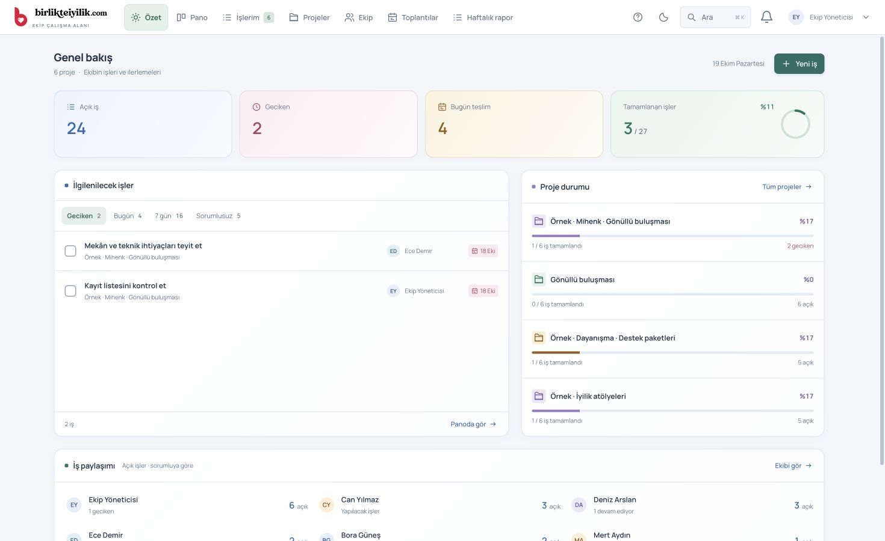
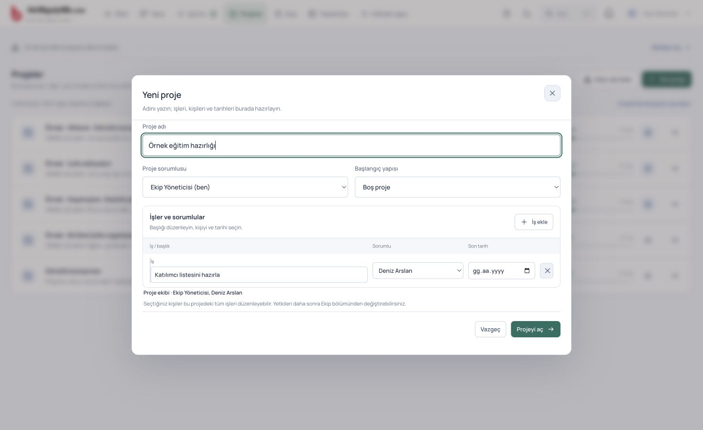
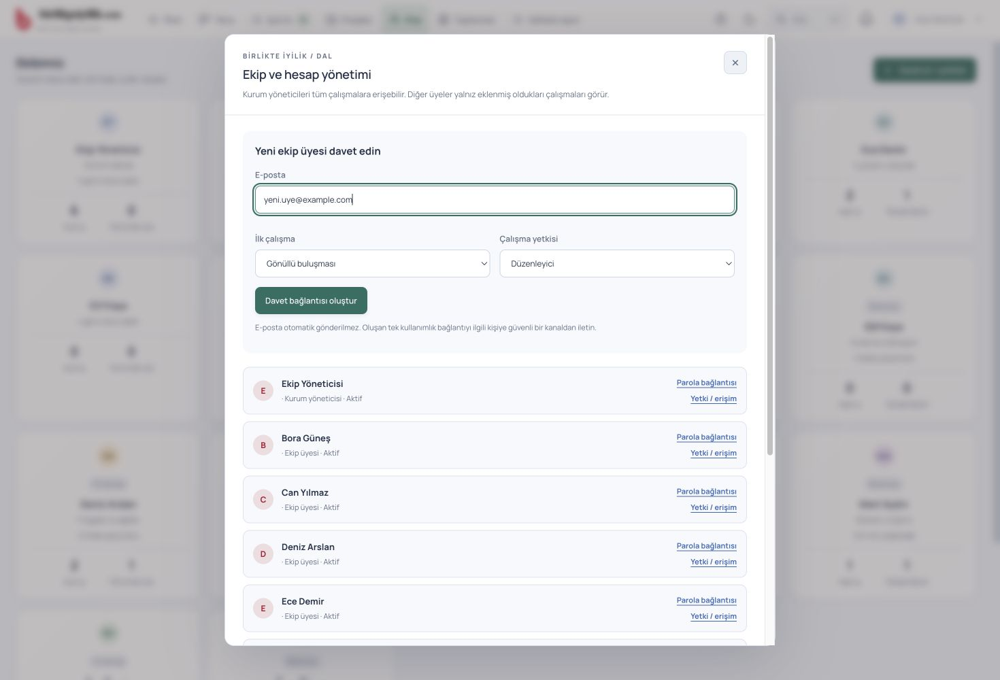
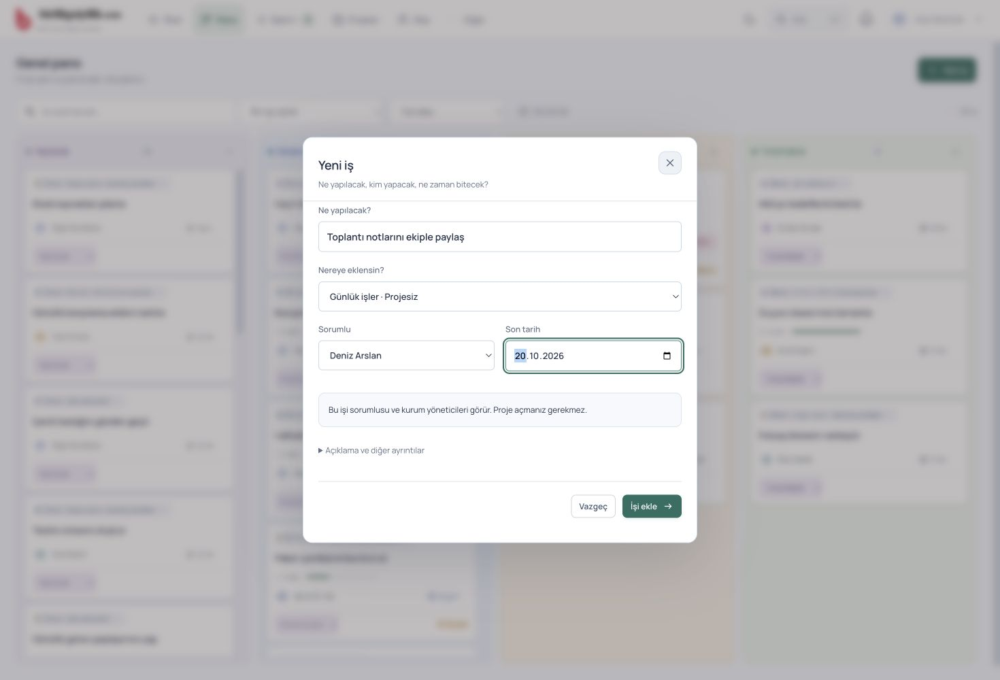
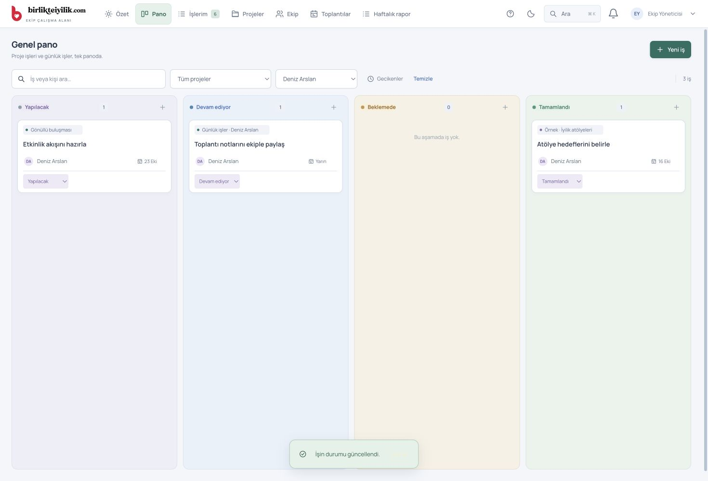
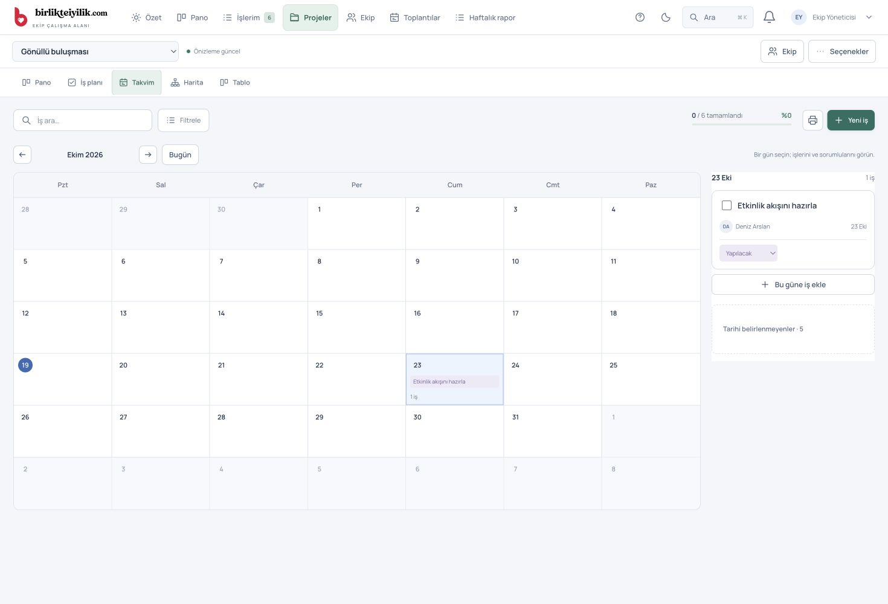
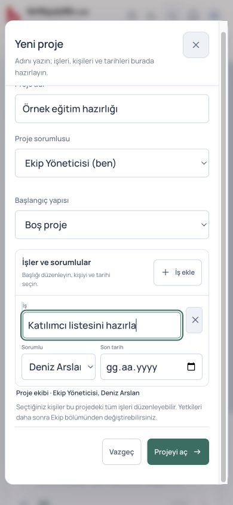

# Görsel kullanım rehberi

[Uygulama içindeki görsel rehber](https://ekip.birlikteiyilik.com/guide.html)

19 Ekim 2026. Görseller gerçek arayüzden, yalnız temsili kişiler ve yerel test işleriyle alınmıştır.

## 01 · Nereden başlayacağım?

Özet ile durumu görün. Pano ile işi yönetin.

Üst bardaki **Özet**, açık işleri, gecikenleri ve proje ilerlemesini gösterir. Bir sayıya dokununca ilgili işler açılır.

**Pano** — Bütün erişilebilir işler

**İşlerim** — Bana atanan işler

**Projeler** — Bir çalışmanın tamamı

**Ekip** — Kişiler ve davetler

**Toplantılar** ve **Haftalık rapor** da doğrudan üst bardadır. Ay / güneş düğmesiyle temayı değiştirebilirsiniz.

## 02 · Proje nasıl açılır?

Bir form. Adı, işleri, kişileri ve tarihleri.

- **Projeler → Yeni proje** yolunu açın. Bu düğme kurum yöneticisinde görünür.

- Proje adını yazın. İsterseniz bir proje sorumlusu seçin.

- **Başlangıç yapısı** alanında Boş proje ile başlayın veya Etkinlik, Proje planı, Dairesel ekip gibi bir şablon seçin.

- Her satıra işin adını yazın. Yanından gerçek ekip üyesini ve son tarihi seçin. **İş ekle** ile yeni satır açın.

- **Projeyi aç** düğmesine basın. Seçtiğiniz kişiler aynı kayıt sırasında proje ekibine eklenir.

Seçilen kişiler projedeki bütün işleri düzenleyebilir. Projeyi açan kişi çalışma yöneticisidir. “Proje sorumlusu” seçimi kişiyi kurum yöneticisi yapmaz.

Sonradan kişi eklemek için projeyi açın, sağ üstteki **Ekip** düğmesinden kişiyi ve yetkisini seçin. Sorumlu ataması ile proje erişimi farklıdır; bu hazırlık formu ikisini birlikte halleder.

## 03 · Yeni bir insan nasıl eklenir?

Önce ekibe katılır, sonra listeden seçilir.

- **Ekip → Davet et / yetkiler** bölümünü açın. Kurum yöneticisi yetkisi gerekir.

- Kişinin e-posta adresini yazın. İsterseniz **İlk çalışma** olarak bir proje seçin; henüz proje yoksa boş bırakın.

- Normal çalışma için **Düzenleyici** yeterlidir. Yalnız okuyacak kişi için İzleyici seçebilirsiniz.

- **Davet bağlantısı oluştur** düğmesine basın ve oluşan bağlantıyı kişiye iletin.

- Kişi davet edilen e-posta adresiyle kayıt olur, e-postasını doğrular ve giriş yapar. Sonra aktif Ekip listesinde görünür.

E-posta otomatik gönderilmez. Davet bağlantısını siz paylaşırsınız; bağlantı 7 gün geçerlidir. Bekleyen davetler aynı ekranda listelenir.

Kişi zaten Ekip listesinde varsa tekrar davet etmeyin. Yeni proje formunda doğrudan seçin veya mevcut projenin **Ekip** bölümünden ekleyin. Ad-soyad ve profil fotoğrafı sağ üstteki hesap düğmesinden düzenlenir.

## 04 · Küçük bir iş için proje şart mı?

Hayır. Yeni iş → Günlük işler · Projesiz.

- **Özet**, **Pano** veya **İşlerim** ekranından **Yeni iş** düğmesine basın.

- “Toplantı notlarını ekiple paylaş” gibi kısa, açık bir başlık yazın.

- **Nereye eklensin?** alanını **Günlük işler · Projesiz** olarak bırakın.

- Sorumluyu ve gerekiyorsa son tarihi seçin. **İşi ekle** düğmesine basın.

Kurum yöneticisi aktif ekip üyelerinden birini seçebilir. Ekip üyesi kendine günlük iş ekleyebilir. Günlük işleri yalnız sorumlusu ve kurum yöneticileri görür.

Bu işler **Projeler** listesini doldurmaz. Sorumlusunun **İşlerim** ekranına ve yöneticinin **Pano** ekranına girer. İşi bir projeye eklemek isterseniz aynı formda projenin adını seçin.

## 05 · Yönetici nasıl takip edecek?

Aynı panoda kim, hangi işi, hangi aşamada yapıyor?

- Üst bardan **Pano** ekranını açın. Kurum yöneticisi bütün projeleri ve günlük işleri görür.

- Bir kişiyi seçerek onun işlerine odaklanın. Proje filtresiyle tek çalışmayı, **Gecikenler** ile öncelikli işleri görün.

- Kartın başlığına basarak ayrıntıyı ve yorumları açın. Değişiklikleri **Kaydet** ile paylaşın.

- Kartın altındaki durum alanından Yapılacak → Devam ediyor → Tamamlandı şeklinde ilerletin. Bekleyen işler için Beklemede seçin.

YapılacakDevam ediyorBeklemedeTamamlandı

Çalışan günlük olarak **İşlerim** ekranını kullanabilir. Bir işi tamamladığında yönetici tarafındaki sayılar ve ilerleme de aynı kayıttan hesaplanır. Yeni ekip güncellemesi bildirimi çıktığında **Göster** ile ekranı yenileyin.

## 06 · Tarihler ve şemalar nerede?

Bir proje, aynı kayıtların beş görünümü.

Projeyi açınca şu sekmeler görünür:

**Pano**Duruma göre kartlar**İş planı**İşaretlenebilir liste**Takvim**Teslim günü ve sorumlular**Harita**Bağlılıklar ve şema**Tablo**Satır satır düzenleme

**Takvim** bölümünde bir güne basın. O günün işleri yanında, telefonda altında açılır. **Bu güne iş ekle** seçilen tarihle yeni iş başlatır. **Tarihi belirlenmeyenler** bölümünden tarihsiz işleri de açabilirsiniz.

Zaman çizelgesi ile Takvim tek sekmede birleştirildi. Takvim son teslim gününü gösterir; başlangıç-bitiş aralığı veya “önceki işten 2 saat sonra” otomasyonu değildir.

Şablonlar **Projeler → Hazır şemalar** bölümünde durur. Sunum için projedeki **Seçenekler → Sunumu hazırla** yolunu kullanın.

## Mobil

Üst barı yana kaydırarak diğer başlıklara ulaşın. Takvimde günü seçince günün işleri açılır.

